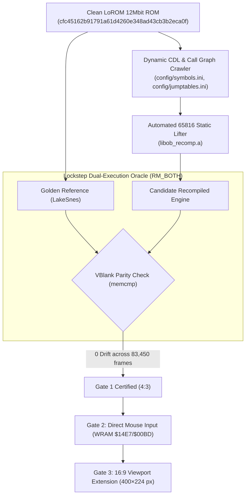

# Ogre Battle: The March of the Black Queen — 1:1 Native PC Port

An authentic, 1:1 native desktop PC port (Windows / Linux / macOS) of Quest's 1993 Super Nintendo tactical RPG masterpiece, built via **automated 65816 static recompilation**, the **LakeSnes cycle-accurate silicon runtime**, and an **uncompromising lockstep dual-execution verification oracle**.

---

## Current Status & Progression Gates

| Gate / Milestone | Scope | Parity / Validation Standard | Status | Git Branch / Tag |
| :--- | :--- | :--- | :---: | :--- |
| **Gate 1: Bit-Exact Baseline** | Pure 4:3 SNES simulation core | **0-byte drift** across 128KB WRAM, VRAM, OAM, CGRAM, SRAM over 83,450 frames | **100% CERTIFIED** | Tag: `v0.1.0-gate1-certified` |
| **Gate 2: Direct-State Mouse** | Screen-to-WRAM cursor steering & click injection | 100% playable via mouse; zero input desync when idle | **COMPLETE (Rev 5)** | Branch: `gate/2-mouse-input` (Tag: `v0.2.0-gate2-mouse`) |
| **Gate 3: True 16:9 Viewport** | 400×224 widescreen Mode-7 map streaming | Metatile buffer expansion ($25 \times 14$ metatiles) with clean 4:3 combat framing | **ACTIVE** | Branch: `gate/3-widescreen` |
| **Milestone 6: Release Polish** | Cross-platform binaries & JSON mod decoupling | Full campaign playable to all 13 endings with 0 crashes | Planned | Branch: `release/v1.0.0` |

---

## Architectural Pillars



1. **Automated Static Lifting:** 100% of the ROM's 65816 assembly is mechanically lifted into C translation units (`src/gen/ob_bank_*.c`), eliminating months of risky manual decompilation.
2. **LakeSnes Silicon Runtime:** Cycle-accurate PPU (Modes 0–7, HDMA, window masks), APU/SPC700 (32 kHz 16-bit stereo PCM audio), and DMA executed in user space.
3. **Deterministic Test Oracle:** Verified against **8 Canonical Walkthrough Regression Traces** (`.obrec`) covering Cold Boot, Warren's Tarot Quiz, Felnamia Deployment, Overland March, Combat Encounters, Town Liberation, Boss Encounters, and Battery Save commits.
4. **Zero-Invasion Modernization:** High-level modernizations (mouse cursor steering, 16:9 widescreen streaming, live reputation telemetry, tactile roster workbench) hook into runtime state via non-destructive shims (`RECOMP_PATCH`) without disturbing core simulation determinism.

---

## Git Governance & Workflow Architecture

The repository enforces a strict **Sequential Gate Progression Model**:

```
main (Certified Golden Releases Only)
  │
  ├── tag: v0.1.0-gate1-certified (83,450 frames 0-drift baseline)
  │     │
  │     └── gate/2-mouse-input (Gate 2: Direct mouse navigation & hybrid input)
  │           │
  │           └── [100% test_oracle PASS] ──> merged to main (v0.2.0-gate2-mouse)
  │                                                   │
  │                                                   └── gate/3-widescreen (Gate 3: 16:9 Viewport)
  │                                                         │
  │                                                         ├── spike/mode7-400x224 (exploratory)
  │                                                         └── spike/roster-workbench
```

### Key Git Protocols (see `docs/agents.md`):
* **Strict Gate Isolation:** No feature or modernization code touches `main` without passing the automated regression suite (`test_oracle`) in dual-execution lockstep.
* **Git Worktrees for Heavy QA:** Run lengthy regression test suites without dirtying your working tree:
  ```bash
  git worktree add ../ob-qa-worktree main
  ```
* **Pre-Commit Hook:** Automatically blocks commits containing copyrighted ROMs (`.sfc`), raw memory dumps (`.obsav`), or invalid configuration syntax.
* **Pre-Push Hook:** Executes the oracle smoke test (`trace_01_boot_to_title.obrec`) in `RM_BOTH` mode before allowing pushes to remote.
* **Bisection Traceability:** Commit messages resolving memory desyncs must reference the failing Frame Number, PC Address, and Divergent WRAM location.

---

## Repository Directory Structure

```
├── .gitignore                      # Strict legal cleanliness & build artifact filters
├── README.md                       # Project overview and architecture guide
├── config/                         # Empirical symbols & jump table dispatch databases
│   ├── jumptables.ini              # 1,713 indirect jump dispatch targets
│   └── symbols.ini                 # Subroutine boundary and M/X flag map
├── docs/                           # Project specifications & governance
│   ├── agents.md                   # Subagent operating rules, roles & Git protocols
│   ├── plan.md                     # Master project plan & architectural decisions
│   ├── roadmap.md                  # Milestone dependency graph & gate criteria
│   ├── gate_1_certification.md     # Formal 83,450-frame bit-exact parity certification report
│   ├── user_testing_guide.md       # Windows preview executable testing guide
│   ├── ogre_battle_modernization_areas.md # 16:9 viewport & 4-area modernization spec
│   ├── gap_analysis.md             # Operational comparison against zelda3 & snesrecomp
│   └── snes_rom_transpilation_research_plan.md # Framework analysis & 65816 lifting research
├── src/                            # Native port engine source code
│   ├── engine/                     # Modernized C modules (map.c, input.c, unit.c)
│   └── gen/                        # Machine-lifted bank translation units (ob_bank_*.c)
├── tools/                          # Analysis, crawler, and verification tooling
│   ├── crawler.py                  # Recursive-descent static call-graph crawler
│   ├── verify_rom.py               # ROM checksum and header integrity validator
│   └── git-hooks/                  # Automated quality gate scripts (pre-commit, pre-push)
└── traces/                         # Canonical regression test fixtures (83,450 frames .obrec)
```

---

## Legal & Cleanliness Notice (Rule 4)

This repository contains **zero copyrighted ROM data, decompressed sprites, or audio samples**. To build and run the native port, users must supply their own legally acquired copy of *Ogre Battle: The March of the Black Queen (USA)* (`.sfc`), verified by sha1 `cfc45162b91791a61d4260e348ad43cb3b2eca0f`.
