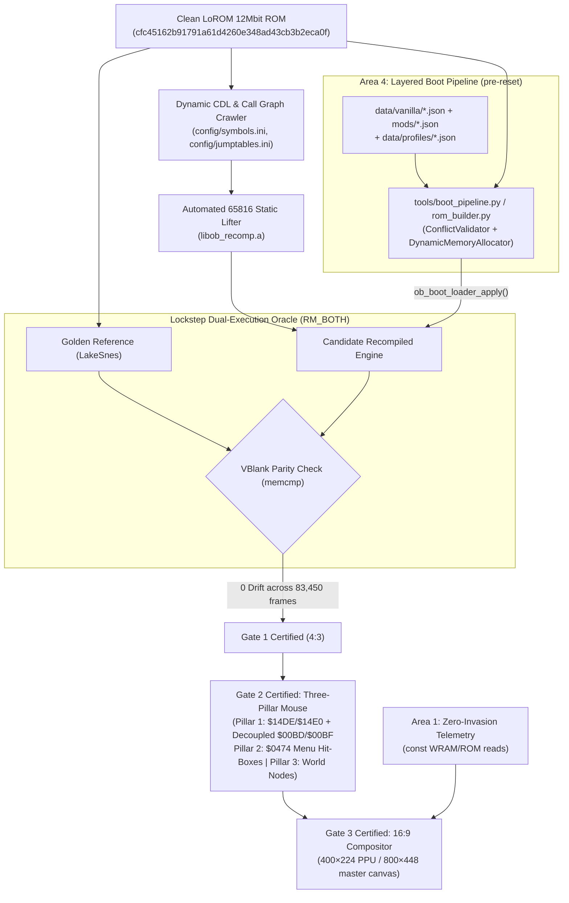

# Ogre Battle: The March of the Black Queen — 1:1 Native PC Port

An authentic, 1:1 native desktop PC port (Windows / Linux / macOS) of Quest's 1993 Super Nintendo tactical RPG masterpiece, built via **automated 65816 static recompilation**, the **LakeSnes cycle-accurate silicon runtime**, and an **uncompromising lockstep dual-execution verification oracle**.

---

## Current Status & Progression Gates

| Gate / Milestone | Scope | Parity / Validation Standard | Status | Git Branch / Tag |
| :--- | :--- | :--- | :---: | :--- |
| **Gate 1: Bit-Exact Baseline** | Pure 4:3 SNES simulation core | **0-byte drift** across 128KB WRAM, VRAM, OAM, CGRAM, SRAM over 83,450 frames | **100% CERTIFIED** | Tag: `v0.1.0-gate1-certified` |
| **Area 1: Zero-Invasion Telemetry** | `const`-only WRAM/ROM telemetry engine, 8 predictive walkthrough models, Mod-Aware Promotion Inspector, 3-page `640×480` SNES-styled Companion Window | 6/6 quality gates, **0-byte drift** across 600 emulated frames | **CERTIFIED** | PR #1 (`feat/telemetry-overlays`) |
| **Gate 2: Three-Pillar Mouse** | 1:1 Direct-State Tactical Cursor (`$14DE/$14E0`), Decoupled Camera (`$00BD/$00BF`), Menu Hit-Box Indexing (`$0474`), & World Map Node Hit-Testing | Gate 2A–2D suite pass; 100% playable via mouse; 0-byte drift when idle (Rev 1–8 synthetic D-Pad deprecated) | **CERTIFIED (Rev 9)** | Tag: `v0.2.0-gate2-mouse` |
| **Gate 3: True 16:9 Widescreen** | Dual-layer `400×224` PPU / `800×448` (`2×`) compositor across all 7 game screens, `144×448` Left/Right Telemetry Wings, `[Tab]` Campaign Grimoire, `[F10]` display modes | Gate 3A–3D suite pass; **0-byte drift** on core simulation; 100% BGR555 palette compliance | **CERTIFIED** | Tag: `v0.3.0-gate3-wide` |
| **Gate 4A / Area 4: Boot-Time Decoupling** | 6 gameplay data domains decoupled into `data/vanilla/*.json`; layered boot pipeline with presets, mod overlays, engine toggles & 1.5MB/2MB memory expansion | **0-byte drift** roundtrip across all 1,572,864 ROM bytes; 15/15 pipeline tests pass | **CERTIFIED** | PR #4 (`gate/4-boot-decoupling`) — tag pending |
| **Milestone 6: Release Polish** | Selective refactoring & cross-platform binaries | Full campaign playable to all 13 endings with 0 crashes | Planned | Branch: `release/v1.0.0` |

---

## Architectural Pillars



1. **Automated Static Lifting:** 100% of the ROM's 65816 assembly is mechanically lifted into C translation units (`src/gen/ob_bank_*.c`), eliminating months of risky manual decompilation.
2. **LakeSnes Silicon Runtime:** Cycle-accurate PPU (Modes 0–7, HDMA, window masks), APU/SPC700 (32 kHz 16-bit stereo PCM audio), and DMA executed in user space.
3. **Deterministic Test Oracle:** Verified against **8 Canonical Walkthrough Regression Traces** (`.obrec`) covering Cold Boot, Warren's Tarot Quiz, Felnamia Deployment, Overland March, Combat Encounters, Town Liberation, Boss Encounters, and Battery Save commits.
4. **Zero-Invasion Modernization:** High-level modernizations (Three-Pillar direct-state mouse & hit-box indexing, 16:9 widescreen compositor, live telemetry wings & Companion Window) hook into runtime state via non-destructive shims (`RECOMP_PATCH`) and `const`-only memory reads without disturbing core simulation determinism.
5. **Boot-Time Data Decoupling:** Class stats, promotions, items, shops, stages, and attack tables live in human-readable JSON manifests. Mods and community patches are assembled into an in-memory ROM buffer **before 65816 reset**, so there is zero runtime CPU overhead and the vanilla profile stays bit-exact.

---

## 16:9 Widescreen Display Modes (Gate 3)

Toggle with **`[F10]`**:

| Mode | Description |
| :--- | :--- |
| `OB_DISPLAY_4_3_PILLARBOX` | Original `256×224` presentation, pillarboxed |
| `OB_DISPLAY_16_9_VANILLA_HORIZON` | Extended Mode-7 scanlines & BG/OAM reveal to `400×224`; Stone & Parchment tapestry borders for fixed 32-tile menus |
| `OB_DISPLAY_16_9_TACTICIAN_WINGS` | Context-switched `144×448 px` Left/Right Wing HUDs populated by Area 1 telemetry (City Compatibility Advisor, Pre-Clash Morality Drift, Clash Tug-of-War, Tarot Guard Dock, etc.) |

Press **`[Tab]`** for the centered **Zenobian Campaign Grimoire** (18 Special Heroes, 12 Zodiac Stones & relics, Bank `$09` Promotion Trees, 2,344-bit Event Diff stream). Mouse input is automatically translated by `+72 px` into core coordinates, and wing panels are clickable. See [`docs/widescreen_16_9_architecture.md`](docs/widescreen_16_9_architecture.md).

---

## Modding & Boot Profiles (Area 4)

Ready-to-run profiles live in [`data/profiles/`](data/profiles/):

| Profile | Base Preset | Memory | Contents |
| :--- | :--- | :---: | :--- |
| `vanilla_purist.json` | `vanilla` | 1.5MB | 100% clean USA LoROM (bit-exact) |
| `community_enhancements.json` | `vanilla` | 2.0MB | Dragoner Rebalance + Magic AI Fix + Crown Drop Fix + Extensible Size Tables |
| `fin_balanced_dragoner.json` | `fin_071` | 2.0MB | Fin's 0.71 Overhaul + Dragoner Rebalance + Magic AI & Crown fixes |
| `class_expansion_overhaul.json` | `class_expansion` | 2.0MB | UPRC Class Expansion (14 new classes) |

```bash
# Assemble a ROM from a boot profile (you must supply your own clean ROM)
python3 tools/boot_pipeline.py --rom path/to/ogre_battle.sfc \
    --config data/profiles/community_enhancements.json --out build/ob_community.sfc

# Verify the vanilla JSON manifests roundtrip to the clean ROM (Gate 4A)
python3 tools/rom_builder.py verify-roundtrip --rom path/to/ogre_battle.sfc

# Decompile a legacy IPS patch into a JSON mod overlay
python3 tools/ips_importer.py --rom path/to/ogre_battle.sfc --patch hack.ips --out mods/my_mod.json

# Generate a deterministic seeded randomizer overlay
python3 tools/randomizer.py --seed zenobia --rom path/to/ogre_battle.sfc --out-manifest mods/my_seed.json
```

The `ConflictValidator` rejects incompatible combinations, such as UPRC Class Expansion together with Bank `$30` engine toggles, or a forced 1.5MB size on a 2MB profile. When overlays overlap, the later overlay wins. Schemas are in [`data/schemas/`](data/schemas/). Full details: [`docs/area_4/boot_pipeline_certification.md`](docs/area_4/boot_pipeline_certification.md).

---

## Build & Test

The same suites run in CI (`.github/workflows/ci.yml`):

```bash
# Gate 2: Three-Pillar Mouse suite
gcc -O2 -Wall -Wextra -Werror src/engine/input.c tests/test_mouse_three_pillar.c -o build/test_mouse_three_pillar
./build/test_mouse_three_pillar

# Gate 3: 16:9 Widescreen & Wing suite
gcc -O2 -Wall -Wextra -Werror src/engine/input.c src/engine/snes_ui_rasterizer.c src/engine/widescreen.c \
    tests/test_widescreen_16_9.c -o build/test_widescreen_16_9
./build/test_widescreen_16_9

# Area 4: Decoupling & boot pipeline suites (ROM-dependent tests need a clean ROM)
PYTHONPATH=tools python3 -m unittest discover -s tests -p "*.py" -v
```

Install the git hooks with `tools/git-hooks/install-hooks.sh`.

---

## Git Governance & Workflow Architecture

The repository enforces a strict **Sequential Gate Progression Model**:

```
main (Certified Golden Releases Only)
  │
  ├── tag: v0.1.0-gate1-certified   (83,450 frames 0-drift baseline)
  ├── feat/telemetry-overlays       ──> PR #1 (Area 1 Zero-Invasion Telemetry)
  ├── gate/2-mouse-input            ──> PR #2 ──> tag: v0.2.0-gate2-mouse
  ├── gate/3-widescreen             ──> PR #3 ──> tag: v0.3.0-gate3-wide
  ├── gate/4-boot-decoupling        ──> PR #4 (Gate 4A / Area 4 Boot-Time Decoupling)
  │
  └── release/v1.0.0                (Milestone 6: planned)
```

### Key Git Protocols (see `docs/agents.md`):
* **Strict Gate Isolation:** No feature or modernization code touches `main` without passing the automated regression suite (`test_oracle`) in dual-execution lockstep.
* **Git Worktrees for Heavy QA:** Run lengthy regression test suites without dirtying your working tree:
  ```bash
  git worktree add ../ob-qa-worktree main
  ```
* **Pre-Commit Hook:** Automatically blocks commits containing copyrighted ROMs (`.sfc`), raw memory dumps (`.obsav`), or invalid configuration syntax.
* **Pre-Push Hook:** Executes the oracle smoke test (`trace_01_boot_to_title.obrec`) in `RM_BOTH` mode before allowing pushes to remote.
* **Bisection Traceability:** Commit messages resolving memory desyncs must reference the failing Frame Number, PC Address, and Divergent WRAM location.
* **Session Handoffs:** Each agent session ends with a handoff record in `docs/handoffs/`.

---

## Repository Directory Structure

> [!NOTE]
> Entries marked ⏳ belong to the Gate 1 recompilation pipeline. They currently live on a cloud development instance and haven't been pushed to this repository yet.

```
├── .github/                        # CI workflow, issue & PR templates
├── .gitignore                      # Strict legal cleanliness & build artifact filters
├── CONTRIBUTING.md                 # Contribution guidelines
├── LICENSE                         # MIT license
├── README.md                       # Project overview and architecture guide
├── config/                         # Empirical symbols & jump table dispatch databases
│   ├── jumptables.ini              # ⏳ 1,713 indirect jump dispatch targets
│   └── symbols.ini                 # ⏳ Subroutine boundary and M/X flag map
├── data/                           # Area 4 decoupled game data
│   ├── vanilla/                    # Canonical manifests (classes, promotions, items, shops, stages, attacks)
│   ├── schemas/                    # JSON Schemas (boot_config, classes, items, stages)
│   └── profiles/                   # Ready-to-run boot profiles
├── mods/                           # JSON mod overlays (Dragoner, Fin 0.71, Class Expansion, engine fixes, randomizer seed)
├── docs/                           # Project specifications & governance
│   ├── agents.md                   # Subagent operating rules, roles & Git protocols
│   ├── plan.md                     # Master project plan & architectural decisions
│   ├── roadmap.md                  # Milestone dependency graph & gate criteria
│   ├── gate_1_certification.md     # Formal 83,450-frame bit-exact parity certification report
│   ├── mouse_architecture_deprecation_and_redesign.md # Gate 2 Rev 1-8 deprecation & Three-Pillar spec
│   ├── widescreen_16_9_architecture.md # Gate 3 dual-layer 16:9 compositor spec
│   ├── developer_guide_area_1_telemetry.md # Area 1 telemetry technical reference
│   ├── player_manual_companion_window.md   # Player-facing Companion Window manual
│   ├── area_4/                     # Area 4 plan, Gate 4A & boot pipeline certifications, RHDN patch catalog
│   ├── handoffs/                   # Per-session agent handoff records
│   ├── user_testing_guide.md       # Windows preview executable testing guide
│   ├── ogre_battle_modernization_areas.md # 16:9 viewport & 4-area modernization spec
│   ├── gap_analysis.md             # Operational comparison against zelda3 & snesrecomp
│   └── snes_rom_transpilation_research_plan.md # Framework analysis & 65816 lifting research
├── include/                        # Public headers (boot_loader, telemetry, telemetry_math, telemetry_window, ob_snes_ui_theme)
├── src/                            # Native port engine source code
│   ├── engine/                     # Modernized C modules
│   │   ├── input.c/.h              # Three-Pillar mouse & widescreen wing docks
│   │   ├── widescreen.c/.h         # 16:9 compositor & scene classifier
│   │   ├── snes_ui_rasterizer.c/.h # Authentic BGR555 SNES UI software rasterizer
│   │   ├── telemetry*.c            # Area 1 telemetry engine, predictive math & Companion Window
│   │   └── boot_loader.c           # Area 4 pre-reset in-memory table injection
│   ├── tools/                      # C tooling (telemetry_trace_runner.c)
│   └── gen/                        # ⏳ Machine-lifted bank translation units (ob_bank_*.c)
├── tests/                          # Gate 2, Gate 3, Area 1 & Area 4 verification suites
├── tools/                          # Analysis, crawler, build, and verification tooling
│   ├── boot_pipeline.py            # Layered boot pipeline (presets, overlays, toggles, conflicts)
│   ├── rom_builder.py              # In-memory ROM assembler & Gate 4A roundtrip verifier
│   ├── extract_rom_tables.py       # Canonical table extractor -> data/vanilla/*.json
│   ├── ips_importer.py             # Legacy IPS/BPS patch -> JSON overlay decompiler
│   ├── randomizer.py               # Deterministic seeded randomizer
│   ├── dump_telemetry_trace.py     # Telemetry trace dumper
│   ├── mine_telemetry_patterns.py  # Pattern Discovery Lab miner
│   ├── extract_snes_ui_assets.py   # SNES UI asset extractor
│   ├── crawler.py                  # ⏳ Recursive-descent static call-graph crawler
│   ├── verify_rom.py               # ⏳ ROM checksum and header integrity validator
│   └── git-hooks/                  # Automated quality gate scripts (pre-commit, pre-push)
└── traces/                         # ⏳ Canonical regression test fixtures (83,450 frames .obrec)
```

---

## Legal & Cleanliness Notice (Rule 4)

This repository does **not** contain a complete or playable ROM image, decompressed sprites, graphics, or audio samples. To build and run the native port, users must supply their own legally acquired copy of *Ogre Battle: The March of the Black Queen (USA)* (`.sfc`), verified by sha1 `cfc45162b91791a61d4260e348ad43cb3b2eca0f`. The build tools (`tools/rom_builder.py`, `tools/boot_pipeline.py`) use that clean ROM as the base template for every build.

### Data manifests disclosure

* **`data/vanilla/*.json`:** gameplay parameters (class stats, growth rates, promotion thresholds, item modifiers, prices, shop stock, stage objectives, encounter tables, and attack names) that `tools/extract_rom_tables.py` extracted from the original ROM so they can be modded. They are structured to the schemas in `data/schemas/` and contain no executable code or audiovisual assets.
* **Schema-only mod overlays:** `dragoner_rebalance.json`, `ob_magic_fix.json`, `tactician_rebalance.json`, and `randomizer_seed_zenobia.json` contain only structured field overrides.
* **Byte-level patch overlays:** `class_expansion.json`, `fin_balancing_071.json`, `ob_engine_patches.json`, `ob_ran_drops.json`, and `ob_size_tables.json` contain raw `vanilla_bytes` / `patched_bytes` records keyed by ROM offset. These records include:
  * excerpts of original ROM bytes, used to verify that a patch applies to a clean ROM. For `class_expansion.json` these are substantial, several hundred KB in total,
  * patch-author 65816 assembly (e.g. Bank `$30` engine hooks), and
  * rewritten string and table data.

  This is a derivative of the original community patches, not the original `.ips` archives.

### Credits & permissions

The mod overlays in `mods/` are derived from community patches catalogued in [`docs/area_4/rhdn_patches_catalog.md`](docs/area_4/rhdn_patches_catalog.md):

| Overlay | Original Patch | Author |
| :--- | :--- | :--- |
| `dragoner_rebalance.json` | Dragoner Promotion Rebalance | Dragoner |
| `fin_balancing_071.json` | Fin's Balancing Mod v0.71 | Fin |
| `ob_engine_patches.json`, `ob_magic_fix.json`, `ob_ran_drops.json`, `ob_size_tables.json` | OB Bug Fixes & Engine Tables | D |
| `class_expansion.json` | OB Class Expansion | UPRC |

All rights to these modifications remain with their original authors. Authors who want their work credited differently, or removed, can open an issue and the corresponding overlay will be updated or taken down.
