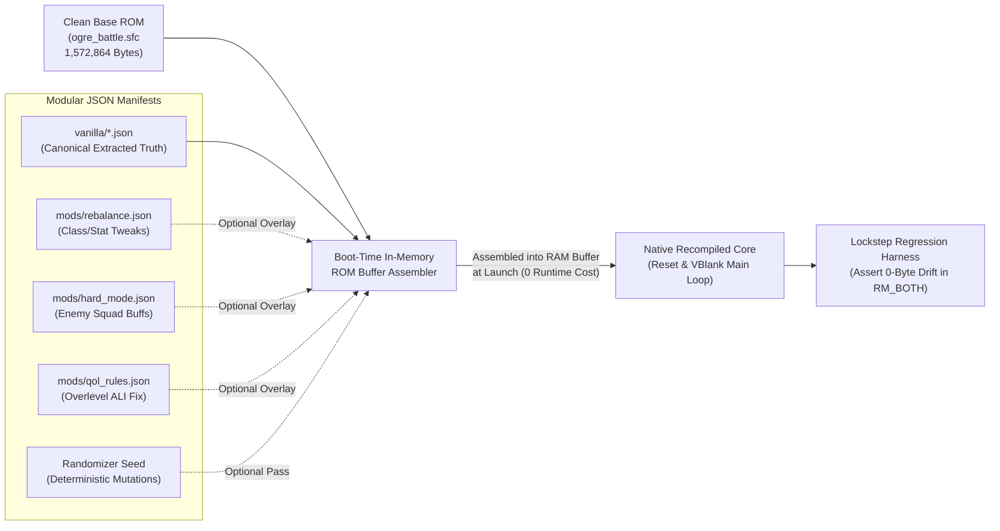
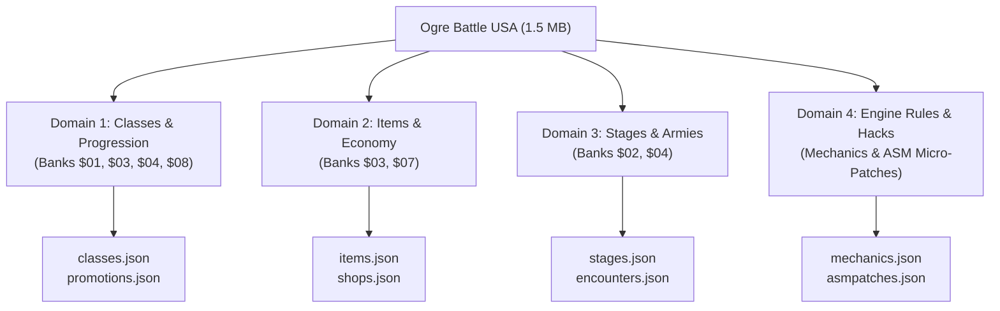
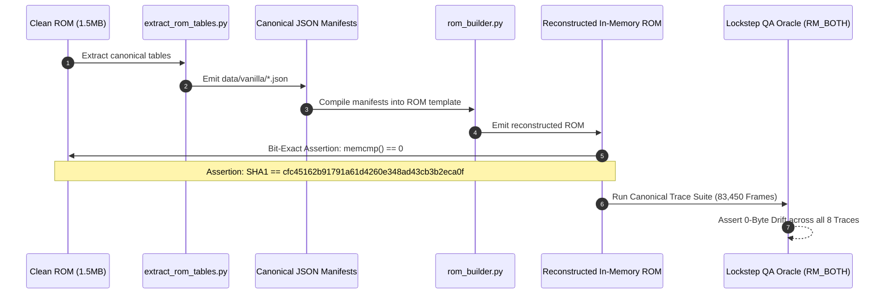

# Implementation Plan: Modernization Area 4 (Boot-Time Decoupling & Modular JSON Builders)

**Project**: *Ogre Battle: The March of the Black Queen* (1:1 Native PC Port)  
**Target Milestone**: Area 4 — Boot-Time Data Table Decoupling (`feat/json-mod-manifests`)  
**Base ROM Target**: SNES LoROM 12Mbit USA (`cfc45162b91791a61d4260e348ad43cb3b2eca0f`, Checksum `$D316`)  
**Status**: **PLAN PROPOSED — READY FOR EXECUTION**

---

## 1. Executive Summary & Core Architectural Premise

Historically, Super Nintendo game modifications, rebalance hacks, and randomizers have been distributed as monolithic binary patches (`.ips` or `.bps`) that overwrite hardcoded ROM banks. This legacy paradigm forces modders into painful hex-editing conflicts, prevents players from combining independent mods (e.g. combining an enemy squad overhaul with a class balance patch), and risks breaking core engine determinism.

**Modernization Area 4 (Boot-Time Decoupling)** transforms the base 1993 `.sfc` ROM into an **immutable code and asset template**. All game rules, class stats, growth formulas, promotion requirements, shop inventories, enemy formations, and mechanics toggles are decoupled into modular, human-readable **JSON Manifests**.



### Core Tenets of Area 4:
1. **Zero Runtime Overhead**: Rather than intercepting table lookups at runtime with slow hashmap/pointer lookups in C, the builder compiles JSON tables directly into the in-memory 1.5MB ROM buffer **once at boot before the 65816 CPU reset vector fires**. The native recompiled C code accesses data at full native speed.
2. **Strict Bit-Exact Oracle Invariance**: When loaded with the extracted `vanilla/*.json` manifest, the compiled in-memory ROM buffer **must match the clean 1993 USA ROM byte-for-byte (0 bytes difference)**.
3. **Additive Composition**: Manifests layer hierarchically: `base_vanilla` $\rightarrow$ `mod_overrides` $\rightarrow$ `randomizer_seed`.
4. **Legality & Clean Distribution**: Zero copyrighted ROM binaries are committed to Git. The builder compiles manifests directly into memory or generates clean delta overlays.

---

## 2. Decoupled Data Domains & Verified ROM Offsets

Through comprehensive static analysis of the verified LoROM image (`cfc45162b91791a61d4260e348ad43cb3b2eca0f`), we have mapped all primary gameplay data structures to exact byte offsets in the 1.5MB ROM:



### Domain 1: Class, Progression & Combat Matrix (`classes.json`, `promotions.json`)
The game defines **125 distinct unit and boss classes** (IDs `$01` *Fighter* through `$7D` *Galf*).

| Parameter / Table | ROM Offset (Hex) | Element Size | Count | Description / Semantics |
| :--- | :---: | :---: | :---: | :--- |
| **Move Type** | `0x17D35` | 1 byte | 125 | Movement category (`00: High Sky, 01: Low Sky, 02: Plains, 03: Forest, 04: Mountain, 05: Snow, 06: Marsh, 07: Shallows, 08: Water, 09: Slow`) |
| **Unit Weight** | `0x17D9A` | 1 byte | 125 | Squad weight capacity calculation |
| **Base Deployment Cost** | `0x17DFF` | 2 bytes (LE) | 125 | Starting Goth recruitment/deployment fee |
| **Deployment Cost / Level** | `0x17EC9` | 2 bytes (LE) | 125 | Incremental daily upkeep fee per unit level |
| **Leadership Flag** | `0x17F93` | 1 byte | 125 | `01` = Can lead a squad; `00` = Subordinate unit only |
| **Base HP** | `0x1EF91` | 2 bytes (LE) | 125 | Base maximum Hit Points |
| **HP Growth / Level** | `0x1F08B` | 1 byte | 125 | Hit Point increase per level up |
| **Base STR** | `0x1F0F0` | 1 byte | 125 | Base Strength attribute |
| **STR Growth / Level** | `0x1F16D` | 1 byte | 125 | Strength increase per level up |
| **Base AGI** | `0x1F1D2` | 1 byte | 125 | Base Agility attribute |
| **AGI Growth / Level** | `0x1F24F` | 1 byte | 125 | Agility increase per level up |
| **Base INT** | `0x1F2B4` | 1 byte | 125 | Base Intelligence attribute |
| **INT Growth / Level** | `0x1F331` | 1 byte | 125 | Intelligence increase per level up |
| **Base CHA** | `0x1F396` | 1 byte | 125 | Base Charisma (`0–100`) |
| **Base ALI** | `0x1F413` | 1 byte | 125 | Base Alignment (`0–100`) |
| **Base LUK** | `0x1F490` | 1 byte | 125 | Base Luck (`0–100`) |
| **Attack Action Count** | `0x1F50D` | 1 byte (Packed) | 125 | High nibble = Front Row attacks, Low nibble = Back Row attacks (e.g. `0x21` = 2 Front / 1 Back) |
| **Front Row Attack ID** | `0x1F572` | 1 byte | 125 | Skill/spell ID executed from the front row |
| **Back Row Attack ID** | `0x1F5D7` | 1 byte | 125 | Skill/spell ID executed from the back row |
| **Physical Resistance** | `0x1F6A1` | 1 byte | 125 | Defense modifier against Physical damage |
| **Fire Resistance** | `0x1F706` | 1 byte | 125 | Defense modifier against Fire element |
| **Cold Resistance** | `0x1F76B` | 1 byte | 125 | Defense modifier against Ice/Cold element |
| **Lightning Resistance**| `0x1F7D0` | 1 byte | 125 | Defense modifier against Electric/Thunder |
| **Black Resistance** | `0x1F835` | 1 byte | 125 | Defense modifier against Dark/Evil element |
| **White Resistance** | `0x1F89A` | 1 byte | 125 | Defense modifier against Holy/White element |
| **Min Level Requirement**| `0x4CED4` | 1 byte | Branches | Minimum character level required to promote |
| **Min ALI Requirement** | `0x4CF21` | 1 byte | Branches | Lower bound of required Alignment |
| **Max ALI Requirement** | `0x4CF6E` | 1 byte | Branches | Upper bound of required Alignment |
| **Min CHA Requirement** | `0x4CFBB` | 1 byte | Branches | Lower bound of required Charisma |
| **Special Promotion Relics**| `0x317A6`–`0x3181A` | Variable | 6 Relics | *Stone of Dragos*, *Undead Staff*, *Undead Ring*, *Blood Kiss*, *Royal Crown*, *Rotten Pumpkin* triggers |
| **Class Names** | `0x8BB29` | Null-term string| 125 | ASCII uppercase class names (`FIGHTER`, `KNIGHT`, etc.) |
| **Attack Names** | `0x8BF4A` | Null-term string| Skills | ASCII attack names (`FIREBALL`, `KATON`, `ICEFIELD`, etc.) |

---

### Domain 2: Equipment, Shops & Items (`items.json`, `shops.json`)
The game defines **196 distinct equipment pieces, tarot cards, and consumables** (`$01` *Sonic Blade* through `$C4` *Stones of the Zodiac*).

| Parameter / Table | ROM Offset (Hex) | Element Size | Count | Description / Semantics |
| :--- | :---: | :---: | :---: | :--- |
| **Item STR Bonus** | `0x3C7A3` | 1 byte (signed) | 100+ | Strength modification when equipped |
| **Item INT Bonus** | `0x3C808` | 1 byte (signed) | 100+ | Intelligence modification when equipped |
| **Item Phys Resistance** | `0x3C86D` | 1 byte (signed) | 100+ | Physical defense modifier |
| **Item Fire Resistance** | `0x3C8D2` | 1 byte (signed) | 100+ | Fire defense modifier |
| **Item Ice Resistance** | `0x3C937` | 1 byte (signed) | 100+ | Ice defense modifier |
| **Item Elect Resistance**| `0x3C99C` | 1 byte (signed) | 100+ | Lightning defense modifier |
| **Item Black Resistance**| `0x3CA01` | 1 byte (signed) | 100+ | Black/Evil defense modifier |
| **Item White Resistance**| `0x3CA66` | 1 byte (signed) | 100+ | White/Holy defense modifier |
| **Item Base Value** | `0x3C612` | 1 byte | 100+ | Purchase price calculation (`Price = Value * 5`) |
| **Stage Shop Inventory** | `0x3CACA` | 5 bytes / stage | 30 stages | 5 item IDs sold at the liberated merchant shops in each stage |
| **Item Names** | `0x3BED6` | Null-term string| Items | ASCII item names (`SONIC`, `DURANDAL`, `BRUNHILD`, etc.) |

---

### Domain 3: Stages, Encounters & Armies (`stages.json`, `encounters.json`)
Covers the **30 campaign stages** across Zenobia (Warren's Castle through Dragon's Haven).

| Parameter / Table | ROM Offset (Hex) | Element Size | Semantics |
| :--- | :---: | :---: | :--- |
| **City Data Table** | `0x2E8C2` | 9 bytes / city | 2-byte name pointer, 2-byte population, 1-byte morale, 1-byte compatibility, 1-byte store type, 1-byte city type, 1-byte base flag. `0xFEFF` marks end of stage. |
| **Neutral Encounters** | `0x2E69F` | 3 bytes / slot | 3 encounters per stage: Location terrain code, unit level, recruited class ID |
| **Enemy Squad Formations** | `0x2E83D` | 7 bytes / squad | Leader ID, 5 unit slots, and 3x2 grid placement mask |
| **Stage Clear Goals** | `0x2D173` | 2 bytes / stage | Clear objective condition codes and stage victory flags |

---

### Domain 4: Engine Rules, Viewport Modes & Micro-Patches (`mechanics.json`)
Exposes configurable behavioral toggles that modify 65816 assembly routines via modular micro-patches:

```json
{
  "viewport_aspect_mode": "16:9_tactician_docks",
  "rules": {
    "disable_overlevel_ali_penalty": true,
    "allow_female_male_cross_promotion": false,
    "tarot_stat_draw_bias": "positive_only",
    "preserve_neutral_recruits_on_retreat": true,
    "unlock_all_stages_in_free_play": false,
    "fast_forward_speed_multiplier": 4.0
  },
  "micro_patches": [
    {
      "id": "ali_overlevel_clamp",
      "description": "NOP out the negative ALI penalty branch when killing lower-level units",
      "rom_offset": "0x0382A0",
      "vanilla_bytes": "F005A901",
      "patched_bytes": "EA48A900"
    }
  ]
}
```

---

## 3. Tooling Suite & Architecture Specifications

We will implement three Python-based engineering tools and one C-level runtime loader:

```
tools/
├── extract_rom_tables.py   # Extracts verified ROM tables into canonical data/vanilla/*.json
├── rom_builder.py          # Merges JSON manifests and patches in-memory ROM buffer
├── ips_importer.py         # Diffs legacy .ips/.bps patches into modular JSON manifests
└── randomizer.py           # Pre-boot seed-based manifest mutator (Profile C)
src/engine/
├── boot_loader.c           # C runtime: Loads JSON manifests & writes to RAM before reset
└── boot_loader.h
data/
├── schemas/                # JSON Schema specifications for strict validation
│   ├── classes.schema.json
│   ├── items.schema.json
│   └── stages.schema.json
└── vanilla/                # Extracted bit-exact canonical vanilla manifests
    ├── classes.json
    ├── promotions.json
    ├── items.json
    ├── shops.json
    └── stages.json
```

### Component 1: `tools/extract_rom_tables.py`
* **Input**: Certified clean `ogre_battle.sfc` (`1,572,864` bytes).
* **Processing**:
  * Reads contiguous binary arrays using verified offsets.
  * Combines split arrays (e.g. `Base HP`, `HP Growth`, `STR`, `AGI`, `INT`, `Attacks`, `Resistances`, `Move Type`, `Name`) into cohesive, human-friendly JSON objects.
  * Extracts strings, trims padding, and matches pointers to names.
* **Output**: Clean, formatted files in `data/vanilla/`.

### Component 2: `tools/rom_builder.py`
* **Input**: Clean base ROM + one or more JSON manifests (e.g. `data/vanilla/*.json` + `mods/rebalance.json`).
* **Processing**:
  * Validates JSON against JSON schemas (`data/schemas/*.json`).
  * Serializes structured JSON records back into raw binary byte vectors.
  * Overwrites target byte ranges in the ROM memory buffer.
  * Recalculates the SNES internal checksum (`$7FDE`–`$7FDF`) and inverted checksum (`$7FDC`–`$7FDD`).
* **Output**: Emittable patched `.sfc` binary or in-memory byte buffer.

### Component 3: `tools/ips_importer.py`
* **Input**: Clean base ROM + legacy mod patch (`mod.ips` or `mod.bps`).
* **Processing**:
  * Decodes IPS/BPS records into a list of modified ROM byte ranges `(offset, old_bytes, new_bytes)`.
  * Cross-references modified ranges against our master table address registry.
  * If changes fall within the class tables $\rightarrow$ emits `classes.json`.
  * If changes fall within item tables $\rightarrow$ emits `items.json`.
  * If changes fall outside known data tables $\rightarrow$ classifies them as `micro_patches` or ASM hooks in `mechanics.json`.
* **Output**: A clean, modular JSON mod pack directory.

---

## 4. Verification Protocol & Quality Gates

To guarantee that Area 4 does not introduce subtle regressions into the certified 4:3 baseline, all deliverables must pass this 3-tier validation matrix:



1. **Gate 4A (Roundtrip Bit-Exact Assertion)**:
   $$\text{reconstruct}(\text{extract}(\text{ROM}_{\text{clean}})) \equiv \text{ROM}_{\text{clean}}$$
   The reconstructed ROM must match the original USA ROM with **0 bytes of difference**, maintaining the identical SHA1 (`cfc45162b91791a61d4260e348ad43cb3b2eca0f`) and Checksum (`$D316`).
2. **Gate 4B (Lockstep Dual-Execution Invariance)**:
   When running the native port loaded with `data/vanilla/*.json`, dual-execution lockstep against the reference interpreter must pass all 8 canonical `.obrec` walkthrough traces (83,450 frames) with **0-byte memory drift**.
3. **Gate 4C (Mod Isolation Test)**:
   A test rebalance manifest modifying only Samurai Master back-row attacks must alter only the target ROM bytes without bleeding into adjacent tables or corrupting pointers.

---

## 5. Phased Implementation Roadmap

```mermaid
gantt
    title Area 4 (Boot-Time Decoupling) Implementation Phases
    dateFormat  X
    axisFormat  Phase %s

    section Phase 1: Extraction
    Map All Table Offsets & Build Extractor   :active, 1, 3
    Validate Canonical JSON Schemas           :2, 4

    section Phase 2: Compilation & Roundtrip
    Implement In-Memory ROM Assembler         :3, 5
    Certify 0-Byte Roundtrip Drift            :4, 6

    section Phase 3: Legacy Importer & Engine Hooks
    Build IPS/BPS Diff-to-JSON Decompiler     :5, 7
    Implement C Engine Boot-Time RAM Loader   :6, 8

    section Phase 4: Presets & Randomizer
    Implement Seeded Mod/Randomizer Engine    :7, 9
    Final QA & Regression Verification        :8, 10
```



### Phase 1: Canonical Extraction & Schema Definitions
- [ ] Implement `tools/extract_rom_tables.py` using verified ROM offsets.
- [ ] Extract `classes.json`, `promotions.json`, `items.json`, `shops.json`, and `stages.json`.
- [ ] Author standard JSON schemas in `data/schemas/` to enforce strict typing on all fields.

### Phase 2: In-Memory ROM Assembler & Roundtrip Certification
- [ ] Implement `tools/rom_builder.py` supporting modular overlay merges.
- [ ] Recalculate SNES internal checksums and LoROM header fields.
- [ ] Execute automated roundtrip unit tests: assert reconstructed ROM SHA1 matches `cfc45162b91791a61d4260e348ad43cb3b2eca0f`.

### Phase 3: Legacy Patch Importer (`ips_importer.py`) & Engine Integration
- [ ] Implement `tools/ips_importer.py` to convert existing community ROM hacks into modular JSON packs.
- [ ] Implement C boot loader routines (`src/engine/boot_loader.c`) to parse and inject JSON manifests into the emulator ROM buffer before `snes_reset()`.

### Phase 4: Seeded Randomizer & Mod Showcase Presets
- [ ] Build a demonstration rebalance mod pack (`mods/tactician_rebalance.json`).
- [ ] Implement deterministic seeded randomizer pass (`tools/randomizer.py`).
- [ ] Run full regression suite (`test_oracle`) to certify engine stability.
