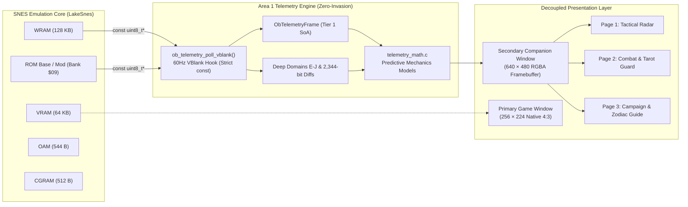
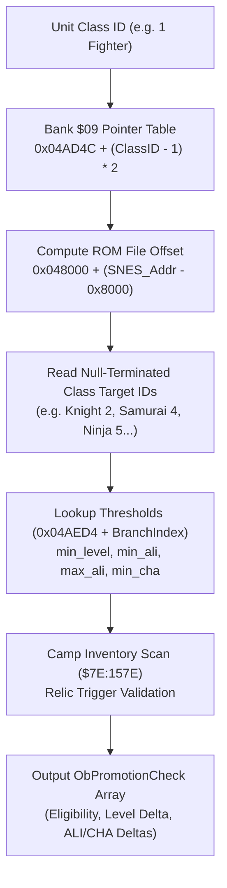

# Modernization Area 1: "Zero-Invasion" Telemetry Layer — Developer Technical Specification

> [!NOTE]
> **Component Scope**: Native PC Port Architecture & Telemetry Engine for *Ogre Battle: The March of the Black Queen* (1993 SNES USA, `cfc45162b91791a61d4260e348ad43cb3b2eca0f`, Checksum `$D316`).
> **Core Principle**: Zero-Invasion. The telemetry layer accesses SNES hardware memory exclusively via `const` pointers, guaranteeing `0-byte` state drift across WRAM, VRAM, CGRAM, and OAM over thousands of emulated frames.

---

## 1. Architectural Principles & Zero-Invasion Invariant

Modernization Area 1 provides a high-fidelity observation layer and a multi-page secondary companion window that extract and visualize live game state without modifying SNES memory or emulated execution flow.



### The Zero-Invasion Invariant
1. **Strict `const` Semantics**: All public and internal telemetry functions accept memory as `const uint8_t *wram` and `const uint8_t *rom`. Writing to these pointers is a compile-time and runtime error.
2. **Dual-Core Lockstep Certification**: Verified via [`test_01_gate_1a_lockstep_zero_invasion`](file:///home/antigravity/tests/test_area_1_telemetry.c#L125-L180), which executes two parallel LakeSnes instances with identical inputs:
   - `Instance A`: Runs vanilla SNES execution without telemetry.
   - `Instance B`: Runs full 60Hz telemetry extraction and companion window rasterization on every VBlank.
   - Result: `0` byte difference across `128 KB` WRAM, `64 KB` VRAM, `512 B` CGRAM, and `544 B` OAM across 600+ frames.
3. **Decoupled Framebuffers**: The primary viewport remains locked at native `256 × 224` (4:3). Telemetry rasterization outputs exclusively to a separate `640 × 480` RGBA buffer ([`ob_telemetry_render_companion_window`](file:///home/antigravity/src/engine/telemetry_window.c#L156-L550)).

---

## 2. Hardware Memory Map & WRAM Domain Layout

SNES WRAM is mapped across Banks `$7E` and `$7F` (`131,072` bytes total). Area 1 partitions this space into Tier 1 (core gameplay data) and Tier 2 (dark-state kinematics, combat accumulators, calendar registers, and event bitflags).

### Tier 1 Domains: Character Roster, Squads & Macro State

| Domain | WRAM Range | Byte Size | Description | C Struct Representation |
| :--- | :--- | :--- | :--- | :--- |
| **Roster Class** | `$7E:07BA`–`$7E:081D` | 100 bytes | Class ID (`1..77`) for 100 roster units | `ObUnitTelemetry.class_id` |
| **Roster Character** | `$7E:085A`–`$7E:08BD` | 100 bytes | Character ID (`1..18` unique heroes, generic) | `ObUnitTelemetry.character_id` |
| **Current HP** | `$7E:099A`–`$7E:0A61` | 200 bytes | 16-bit LE current HP per unit | `ObUnitTelemetry.hp_cur` |
| **Max HP** | `$7E:0ADA`–`$7E:0BA1` | 200 bytes | 16-bit LE max HP per unit | `ObUnitTelemetry.hp_max` |
| **Charisma (`CHA`)** | `$7E:0C1A`–`$7E:0C7D` | 100 bytes | Unit charisma (`0..100`) | `ObUnitTelemetry.cha` |
| **Tarot Hand** | `$7E:0DBE`–`$7E:0DCB` | 14 bytes | Active Tarot hand cards (`0..21`, empty sentinel `0xFF`) | `ObTelemetryFrame.tarot_hand` |
| **Squad Leaders** | `$7E:0DCD`–`$7E:0DE5` | 25 bytes | Roster index of squad leader (`0..99`, `0xFF` empty) | `ObSquadTelemetry.leader_unit_id` |
| **Squad Members** | `$7E:0E81`–`$7E:0EFD` | 125 bytes | 5 unit slots per squad across 25 squads | `ObSquadTelemetry.member_ids[5]` |
| **Calendar Clock** | `$7E:156D`–`$7E:1575` | 7 bytes | Year, Month, Day, Hour, Minute, Second, Subtick | `ObCelestialTelemetry` |
| **Goth Treasury** | `$7E:1578`–`$7E:157B` | 4 bytes | 32-bit LE gold treasury | `ObTelemetryFrame.goth_treasury` |
| **Chaos Frame** | `$7E:157C`–`$7E:157D` | 2 bytes | CF value (`0..100`) + fractional accumulator | `ObTelemetryFrame.chaos_frame` |
| **Camp Inventory** | `$7E:157E`–`$7E:15BD` | 64 bytes | Item IDs in camp storage | `ObTelemetryFrame.camp_inventory` |
| **Level** | `$7E:F148`–`$7E:F1AB` | 100 bytes | Unit level (`1..99`) | `ObUnitTelemetry.level` |
| **Strength (`STR`)** | `$7E:F24C`–`$7E:F2AF` | 100 bytes | Physical attack power | `ObUnitTelemetry.str` |
| **Agility (`AGI`)** | `$7E:F2EC`–`$7E:F34F` | 100 bytes | Turn speed and evasion | `ObUnitTelemetry.agi` |
| **Intelligence (`INT`)**| `$7E:F38C`–`$7E:F3EF` | 100 bytes | Magic attack and magic defense | `ObUnitTelemetry.inte` |
| **Alignment (`ALI`)** | `$7E:F42C`–`$7E:F48F` | 100 bytes | Unit moral alignment (`0..100`) | `ObUnitTelemetry.ali` |
| **Luck (`LUK`)** | `$7E:F490`–`$7E:F4F3` | 100 bytes | Critical rate and item discovery | `ObUnitTelemetry.luk` |
| **Total EXP** | `$7E:F4F4`–`$7E:F5BB` | 200 bytes | 16-bit LE experience points | `ObUnitTelemetry.exp` |

### Tier 2 Deep Domains: Kinematics, Combat & Event Bitmaps

| Domain | WRAM Range | Byte Size | Description | Struct / Array |
| :--- | :--- | :--- | :--- | :--- |
| **Domain E: Deployed Entity X** | `$7E:18AF`–`$7E:18D7` | 42 bytes | 16-bit LE World X coordinate (`0..20` slots) | `ObMapEntityTelemetry.world_x` |
| **Domain E: Deployed Entity Y** | `$7E:18D9`–`$7E:1901` | 42 bytes | 16-bit LE World Y coordinate (`0..20` slots) | `ObMapEntityTelemetry.world_y` |
| **Domain E: Target Coordinate X** | `$7E:1905`–`$7E:1929` | 40 bytes | 16-bit LE Target X waypoint | `ObMapEntityTelemetry.target_x` |
| **Domain E: Target Coordinate Y** | `$7E:192D`–`$7E:1951` | 40 bytes | 16-bit LE Target Y waypoint | `ObMapEntityTelemetry.target_y` |
| **Domain E: Sub-pixel Velocity X**| `$7E:1955`–`$7E:1979` | 40 bytes | Signed 16-bit sub-pixel velocity `dX` | `ObMapEntityTelemetry.vel_dx` |
| **Domain E: Sub-pixel Velocity Y**| `$7E:197D`–`$7E:19A1` | 40 bytes | Signed 16-bit sub-pixel velocity `dY` | `ObMapEntityTelemetry.vel_dy` |
| **Domain E: Tactical AI Order** | `$7E:19A5`–`$7E:19B9` | 21 bytes | AI order code (`$00` Roam, `$01` Seek Lord, `$02` March City) | `ObMapEntityTelemetry.ai_behavior_flags` |
| **Domain E: Fatigue Stun Timer** | `$7E:19CD`–`$7E:19E1` | 21 bytes | Post-combat paralysis countdown | `ObMapEntityTelemetry.fatigue_ticks` |
| **Domain F: City World X** | `$7E:1A95`–`$7E:1ABD` | 40 bytes | 16-bit LE City World X coordinate (`0..19`) | `ObCityTelemetry.world_x` |
| **Domain F: City World Y** | `$7E:1B0D`–`$7E:1B35` | 40 bytes | 16-bit LE City World Y coordinate (`0..19`) | `ObCityTelemetry.world_y` |
| **Domain F: City Tribute Goth** | `$7E:1B5D`–`$7E:1B85` | 40 bytes | 16-bit LE Daily Noon tribute payout | `ObCityTelemetry.noon_tribute_goth` |
| **Domain F: City Compatibility** | `$7E:1C25`–`$7E:1C38` | 20 bytes | Target liberation alignment (`0..100`) | `ObCityTelemetry.compatibility` |
| **Domain F: City Ownership Mask** | `$7E:1C4D`–`$7E:1C60` | 20 bytes | Bitmask: `0x01` Liberated, `0x02` Hidden, `0x04` Temple | `ObCityTelemetry.ownership_mask` |
| **Domain G: Player Cumulative Dmg**| `$7E:F942`–`$7E:F943` | 2 bytes | 16-bit LE combat clash damage dealt by player | `ObCombatTelemetry.player_clash_damage` |
| **Domain G: Enemy Cumulative Dmg** | `$7E:F944`–`$7E:F945` | 2 bytes | 16-bit LE combat clash damage dealt by enemy | `ObCombatTelemetry.enemy_clash_damage` |
| **Domain J: 2,344-Bit Event Bitmap**| `$7E:8600`–`$7E:8F27` | 293 bytes | 2,344 continuous bitflags serialized by SRAM `$00:82C0` | `ObTelemetryFrame.event_bitflags` |

---

## 3. Dynamic Mod-Aware Promotion Engine (ROM Bank `$09`)

Unlike traditional hardcoded emulators or translation patches, Area 1 dynamically parses SNES ROM Bank `$09` tables at runtime. If a ROM hack or balance patch changes class requirements, the telemetry engine reflects those changes immediately without recompilation.



### Table Layout in Bank `$09`
1. **Branch Pointer Table**: `0x04AD4C` (`$09:AD4C` in LoROM). 16-bit Little-Endian pointers relative to Bank `$09` (`$8000..$FFFF`).
2. **Promotion Threshold Arrays**:
   - `0x04AED4`: Minimum Level (`min_level`) array across all 89 promotion branches.
   - `0x04AF21`: Minimum Alignment (`min_ali`) array.
   - `0x04AF6E`: Maximum Alignment (`max_ali`) array.
   - `0x04AFBB`: Minimum Charisma (`min_cha`) array.
3. **Relic Promotions**:
   - Evaluated dynamically against Camp Inventory (`$7E:157E`).
   - Supports: Undead Ring (`$4A` -> Lich), Royal Crown (`$59` -> Princess), Blood Kiss (`$4C` -> Vampire), Rotten Pumpkin (`$4D` -> Halloween), and Dragoner Stone (`$49` -> Dragoon).

---

## 4. Predictive Algorithms & Walkthrough Mechanics (Phase 5B)

The predictive math engine in [`src/engine/telemetry_math.c`](file:///home/antigravity/src/engine/telemetry_math.c) provides 8 distinct walkthrough models to demystify SNES mechanics.

### 4.1 `-5 CF` Recapture Threat Detection
- **Function**: [`ob_telemetry_detect_recapture_threats`](file:///home/antigravity/src/engine/telemetry_math.c#L330-L375)
- **Mathematical Model**:
  $$\text{Dist} = |X_{\text{enemy}} - X_{\text{city}}| + |Y_{\text{enemy}} - Y_{\text{city}}|$$
  $$\text{Closing} = (\Delta X \cdot V_x > 0) + (\Delta Y \cdot V_y > 0)$$
- **Logic**: Evaluates all active enemy slots (`10..20`) against all liberated nodes (Ownership mask bit `0 == 1`). If the enemy's target coordinates match the node or if $\text{Dist} \le 180\text{ px}$ with a positive closing velocity vector, a threat record is dispatched with $\text{ETA} = \frac{\text{Dist}}{\text{Speed}}$ and a fixed `penalty_cf = -5`.

### 4.2 Tarot Hand Audit & Leader Overlevel Guard
- **Function**: [`ob_telemetry_audit_tarot_hand`](file:///home/antigravity/src/engine/telemetry_math.c#L475-L545)
- **SNES Quirk**: In *Ogre Battle*, damage kills dealt by Tarot cards do not distribute EXP to squad members. **100% of kill EXP and morality delta is awarded directly to Unit #00 (Opinion Leader)**.
- **Risk Assessment**:
  $$\text{Offensive Cards} \in \{\text{Magician}(0), \text{Justice}(7), \text{Tower}(8), \text{Judgement}(10), \text{Sun}(12), \text{Star}(16), \text{Moon}(17), \text{Chariot}(6), \text{Death}(11), \dots\}$$
  $$\text{Overlevel Risk} = \text{IsOffensive} \land (\text{Leader Level} \ge 4)$$
  If triggered, the Companion Window warns the player that using this card against lower-level enemies will degrade Opinion Leader alignment, permanently locking out the best endings (*The World*, *The Sun*).

### 4.3 Neutral Encounter & Persuasion Forecasting
- **Function**: [`ob_telemetry_forecast_neutral_encounters`](file:///home/antigravity/src/engine/telemetry_math.c#L376-L472)
- **Logic**: Reads the underlying terrain ID from Domain E (`$7E:1A11 + slot*2`). Cross-references squad unit classes:
  - **Forest (Terrain 2)**: Spawns Ghosts/Skeletons (Lv 9). If squad has a Cleric or Princess, flags `persuade_ready = true` and `is_undead_ali_farm = true`.
  - **Mountain (Terrain 3)**: Spawns Griffons/Cockatrices (Lv 8). Requires Beast Master. If squad has Witch and inventory contains Glass Pumpkin (`$4D`), activates `is_pumpkin_ali_tank = true`.
  - **Swamp (Terrain 5)**: Spawns Wraiths/Phantoms (Lv 21). Holy recruit farm.
  - **Desert (Terrain 6)**: Spawns Salamanders/Wyrms (Lv 17). Beast Master recruit.
  - **Water (Terrain 7/8)**: Spawns Octopi/Krakens (Lv 10). Beast Master recruit.
  - **Plains / Road (Terrain 1)**: Spawns Dragons/Hawkmen (Lv 7). Beast Master or Wizard recruit.

### 4.4 18 Special Character Recruitment Auditor
- **Function**: [`ob_telemetry_audit_special_recruits`](file:///home/antigravity/src/engine/telemetry_math.c#L546-L620)
- **Coverage**: All 18 named characters: Lans, Warren, Canopus, Ashe, Lyon, Yushis, Saradin, Tristan, Rauny, Debonair, Norn, Slust, Fenril, Aisha, Fogel, Destro, Deneb, Galf.
- **Tradeoff Engine**:
  - **Deneb (`#16`)**: Flags requirement $\text{CF} \le 35$ and $\text{Leader ALI} \le 40$. Injects tradeoff alert: `"Forfeits Halloween Ending & High CF"`.
  - **Galf (`#17`)**: Flags requirement $\text{CF} \le 20$ and $\text{Leader ALI} \le 30$. Injects irreversible tradeoff alert: `"Irrevocably forfeits Top 3 Endings (World/Sun/Justice)"`.

### 4.5 12 Zodiac Stones & Tablet of Yaru Checklist
- **Function**: [`ob_telemetry_track_zodiac_stones`](file:///home/antigravity/src/engine/telemetry_math.c#L671-L715)
- **Item Mapping**: Scans `$7E:157E..$7E:15BD` for Quicksilver (`0x45`), Tablet of Yaru (`0x49`), and Zodiac Stones 1–12 (`0x50..0x5B`: Garnet, Amethyst, Aquamarine, Diamond, Emerald, Pearl, Ruby, Peridot, Sapphire, Opal, Topaz, Turquoise).
- **Brunhild Eligibility**:
  $$\text{Brunhild Ready} = \text{HasQuicksilver} \land \text{HasTabletOfYaru} \land (\text{StonesCount} == 12)$$

### 4.6 Squad Mobility & Flyer Upgrade Advisor
- **Function**: [`ob_telemetry_analyze_squad_mobility`](file:///home/antigravity/src/engine/telemetry_math.c#L625-L670)
- **Mobility Classes**: Normal, Plains, Forest, Mountain, Low Sky, High Sky.
- **Elevation Calculation**:
  $$\text{Flyers Needed} = \max(0, \lceil \text{Total Members} / 2 \rceil - \text{Current Flyers})$$
  Advises how many Griffons, Cockatrices, Eaglemen, or Ravenmen are needed to convert a ground squad into a Low Sky flying squad that ignores terrain friction.

---

## 5. Secondary Companion Window Rasterizer

The Companion Window rasterizer ([`src/engine/telemetry_window.c`](file:///home/antigravity/src/engine/telemetry_window.c)) is a self-contained, software renderer that draws into a `640 × 480` 32-bit RGBA pixel array:

### Visual Page Layouts

```
+-------------------------------------------------------------------------------+
| TOP BAR: [PAGE TABS: 1.TACTICAL | 2.COMBAT/TAROT | 3.CAMPAIGN]  [POI TOGGLE] |
+---------------------------------------+---------------------------------------+
| QUADRANT 1 (PAGE SPECIFIC)            | QUADRANT 2 (PAGE SPECIFIC)            |
|                                       |                                       |
| Page 1: Chaos Frame, Treasury, Clock  | Page 1: 2D Spatial Intercept Radar    |
| Page 2: Combat Tug-of-War & Tarot Hand| Page 2: Neutral Matrix & Mobility Adv |
| Page 3: 18-Hero Recruitment Auditor   | Page 3: Zodiac Stones & Warren Quiz   |
|                                       |                                       |
+---------------------------------------+---------------------------------------+
| QUADRANT 3 (PAGE SPECIFIC)            | QUADRANT 4 (PAGE SPECIFIC)            |
|                                       |                                       |
| Page 1: Recapture Alert & Town Match  | Page 1: Squad Coordinates & AI State  |
| Page 2: Pre-Clash Morality Drift Table| Page 2: Mod-Aware Promotion Inspector |
| Page 3: Lord Archetype & Alignment    | Page 3: 2,344-Bit Event Diff Stream   |
|                                       |                                       |
+---------------------------------------+---------------------------------------+
```

### Rendering Pipeline
- **Primitives**: `draw_rect_fill()`, `draw_rect_outline()`, `draw_char()`, `draw_text()`.
- **Built-in Font**: 5x7 ASCII bitmap table with dedicated glyphs for pipes (`|`), arrows (`->`), and status symbols.
- **Coordinate Projection**: World coordinates (`0..1024 px`) are mapped to radar canvas space (`136 × 96 px`) via affine transform.
- **Output Interfaces**:
  - Framebuffer pointer: `uint32_t *out_rgba_buffer`
  - PPM snapshot export: [`ob_companion_window_save_ppm`](file:///home/antigravity/src/engine/telemetry_window.c#L130-L154)

---

## 6. C API Reference

All declarations reside in [`include/telemetry.h`](file:///home/antigravity/include/telemetry.h), [`include/telemetry_math.h`](file:///home/antigravity/include/telemetry_math.h), and [`include/telemetry_window.h`](file:///home/antigravity/include/telemetry_window.h).

### Lifecycle & Telemetry Extraction
```c
void ob_telemetry_init(ObTelemetryState *state);

void ob_telemetry_poll_vblank(
    const uint8_t *wram,
    const uint8_t *rom,
    uint32_t rom_size,
    uint64_t frame_number,
    ObTelemetryFrame *out_frame
);

size_t ob_telemetry_diff_frames(
    const ObTelemetryFrame *prev_frame,
    const ObTelemetryFrame *curr_frame,
    ObTelemetryDiffEvent *out_diffs,
    size_t max_diffs
);
```

### Predictive Mechanics (Phase 5B)
```c
size_t ob_telemetry_detect_recapture_threats(
    const ObTelemetryFrame *frame,
    ObRecaptureThreat *out_threats,
    size_t max_threats
);

void ob_telemetry_forecast_neutral_encounters(
    const ObTelemetryFrame *frame,
    uint8_t squad_index,
    ObNeutralSpawnForecast *out_forecast
);

size_t ob_telemetry_audit_tarot_hand(
    const ObTelemetryFrame *frame,
    ObTarotAudit *out_audits,
    size_t max_cards
);

size_t ob_telemetry_audit_special_recruits(
    const ObTelemetryFrame *frame,
    ObHeroRecruitmentAudit *out_audits,
    size_t max_heroes
);

void ob_telemetry_track_zodiac_stones(
    const ObTelemetryFrame *frame,
    ObZodiacQuestStatus *out_status
);

void ob_telemetry_analyze_squad_mobility(
    const ObTelemetryFrame *frame,
    uint8_t squad_index,
    ObSquadMobilityAnalysis *out_analysis
);

void ob_telemetry_preview_lord_archetype(
    const ObTelemetryFrame *frame,
    ObLordArchetypePreview *out_preview
);

void ob_telemetry_audit_hidden_poi(
    const ObTelemetryFrame *frame,
    ObHiddenPoISummary *out_summary
);
```

### Companion Window Control
```c
void ob_companion_window_init(ObCompanionWindowState *state);
void ob_companion_window_cycle_page(ObCompanionWindowState *state);
void ob_companion_window_toggle_poi(ObCompanionWindowState *state);

void ob_telemetry_render_companion_window(
    const ObCompanionWindowState *state,
    const ObTelemetryFrame *prev_frame,
    const ObTelemetryFrame *curr_frame,
    const uint8_t *wram,
    const uint8_t *rom,
    uint32_t rom_size,
    uint32_t *out_rgba_buffer,
    uint32_t width,
    uint32_t height
);
```

---

## 7. Build, Verification & Testing Protocols

The full suite is compiled and executed via:

```bash
# Build and execute the 6-gate certification suite
gcc -O2 -Wall -Wextra -Iinclude -Ithird_party/LakeSnes/snes \
    src/engine/telemetry.c \
    src/engine/telemetry_math.c \
    src/engine/telemetry_window.c \
    tests/test_area_1_telemetry.c \
    third_party/LakeSnes/snes/*.c \
    -lm -o build/test_area_1_telemetry

./build/test_area_1_telemetry /path/to/ogre_battle.sfc
```

### Headless Trace & Pattern Discovery Tools
- **Trace Extractor**: `python3 tools/dump_telemetry_trace.py --rom ogre_battle.sfc --out build/trace.jsonl --ppm /tmp/window.ppm`
- **Pattern Lab**: `python3 tools/mine_telemetry_patterns.py --trace build/trace.jsonl --rom ogre_battle.sfc`
