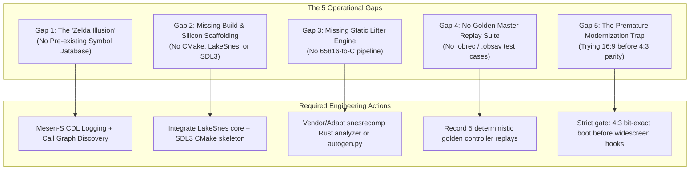

# Critical Comparison & Gap Analysis: Ogre Battle SNES 1:1 PC Port

## Executive Verdict

**Are we set up for success?**
* **Architecturally & Strategically:** **Yes.** Choosing **Approach 3 (Hybrid Extended PPU)**, lockstep dual-execution validation, hybrid direct-state mouse control, and explicit agent governance rules (`AGENTS.md`) avoids the catastrophic pitfalls that caused previous retro graphics ports to fail.
* **Operationally & Infrastructure-wise:** **Not yet.** If development were to begin today relying solely on our current assets, the project would stall within three days. There are **five critical operational gaps** between our current repository state and the baseline required by historically successful projects (`snesrev/zelda3`, `snesrecomp/MegaManX`, and `ogre-battle-64-recomp`).

---

## 1. Comparative Matrix: Our Project vs. Proven Successes

| Capability Dimension | `snesrev/zelda3` (SNES) | `snesrecomp / MegaManX` (SNES) | `ogre-battle-64-recomp` (N64) | **Our Project (Current State)** |
| :--- | :--- | :--- | :--- | :--- |
| **Prior Community Knowledge Base** | **Massive.** Decades of ALttP hacking; Spannerism's complete JP disassembly; ~90% of WRAM variables named. | **Extensive.** Complete disassembly (`mmx-disasm`); fully mapped object, physics, and stage tables. | **Moderate.** N64 splat symbol mapping + known RAM offsets for units/chaos frame. | **Near Zero.** The only public repo (`BacteriaMage`) has only 1 labeled vector (`Reset`) and empty docs. No community RAM map exists. |
| **Automated Toolchain** | Custom x86 intermediate lifter + IDA Pro decompiler + Python regex post-processors. | Rust static analyzer + `autogen.py` generator + tiered interpreter fallback. | `splat64` MIPS disassembler + `N64Recomp` automated C translator. | **Planned only.** No analyzer, lifter, or generator currently exists in our workspace. |
| **Hardware Runtime Scaffolding** | Embedded LakeSnes PPU/DSP core; optimized C SDL2 frontend ready on Day 1. | Drop-in `snesrecomp` static library; beam-aligned raster driver; SDL2/SDL3. | `RT64` DirectX 12/Vulkan renderer + `N64ModernRuntime`. | **Zero code.** Workspace has no CMake build, no LakeSnes submodule, no SDL window. |
| **Deterministic Test Oracle** | `RM_BOTH` dual-execution comparing 128 KB WRAM every frame; joypad replay log. | `--headless --record` conformance harness; golden master hash checks per build. | Framebuffer capture diffs (`rt64_target.py`) + save state test passes. | **Specified on paper (`PLAN.md`), but zero lines of test runner code written.** |
| **Subagent Execution Discipline** | Handcrafted by 1–3 elite human reverse engineers over years. | Team of human emulator devs + automated CI verification suites. | 140+ AI agent sessions governed by `AGENTS.md` and rigid handoff logs. | **Adopted `AGENTS.md` & handoffs, but lacks automated code linters/test gates to enforce them.** |

---

## 2. The Five Fatal Gaps & How to Bridge Them

---

### Gap 1: The "Zelda Illusion" (Zero Community Symbols for Ogre Battle)
* **The Vulnerability:** `snesrev/zelda3` and `snesrev/smw` were not created by de novo reverse engineering. They converted *already completely understood and labeled disassemblies* into C. In contrast, our investigation of `BacteriaMage/ogre-battle-disassembly` revealed that the community has mapped almost nothing: only the single Reset vector `$00:8000` is documented, with zero WRAM maps.
* **The Risk:** If an AI agent attempts to lift Bank 00 without understanding what memory addresses mean, it will generate unreadable C code (`g_ram[0x1842] = g_ram[0x05F2] + 4;`) with hundreds of anonymous `sub_00A492` calls, making camera buffer extension and mouse coordinate injection nearly impossible.
* **The Fix:** We must generate an empirical symbol database ourselves before touching gameplay code:
  1. Run **Mesen-S with Code/Data Logging (CDL)** across a full 1-hour gameplay session (Title, Warren's Tarot, Stage 1 Sharom, Battle, Liberation).
  2. Use a recursive static crawler to map all entry points and jump tables.

---

### Gap 2: The Missing Compilation & Silicon Runtime Scaffolding
* **The Vulnerability:** Right now, `/home/antigravity` contains only Markdown plans. We have no `CMakeLists.txt`, no compiler toolchain set up, and no LakeSnes/SDL3 library checked out.
* **The Risk:** Agents will spin cycles writing conceptual C functions that cannot be compiled, linked, or executed.
* **The Fix:** Execute **Milestone 0 immediately**:
  1. Create a minimal `CMakeLists.txt` targeting C11 / C++17.
  2. Add LakeSnes as a clean submodule or vendored static library under `third_party/lakesnes`.
  3. Compile a basic executable that opens an SDL3 window and boots the uncompressed `/tmp/ogre_battle.sfc` ROM through LakeSnes.

---

### Gap 3: Automated Static Lifting vs. Manual Decompilation Bottleneck
* **The Vulnerability:** *Ogre Battle* is a 12 Mbit (1.5 MB) ROM with an estimated 1,500 to 2,500 subroutines. A pure manual decompilation effort (writing idiomatic C function-by-function) would take an agentic team hundreds of sessions and suffer from catastrophic context drift.
* **The Risk:** Getting stuck in "Milestone 4" forever, rewriting low-level math routines instead of reaching a playable game.
* **The Fix:** Follow the `snesrecomp` model:
  1. Use an automated lifter (`autogen.py` or the Rust analyzer from `RetroPortingToolKit/snesrecomp`) to mechanically lift 100% of the ROM's 65816 code into raw, instruction-level C (`op_lda`, `op_sta`, `bus_write8`) inside `src/gen/`.
  2. Boot the game on day 1 with the automated C code.
  3. **Only refactor the high-level subsystems needed for modernization** (`map.c` for 16:9, `input.c` for mouse, `unit.c` for stats). Leave low-level DMA/math routines in their generated state!

---

### Gap 4: Absence of Golden Master Replay Traces (`.obrec` / `.obsav`)
* **The Vulnerability:** A lockstep test harness (`RM_BOTH`) is useless without reproducible input streams. If you only test by manually clicking keys, subtle divergences in random number generation (`NextRandom`) or squad morale math will go unnoticed until hours later.
* **The Risk:** Undetected silent desyncs corrupting save RAM.
* **The Fix:** Create a replay recorder during Milestone 1:
  1. Record 5 standard `.obrec` controller traces on the golden reference emulator:
     * `trace_01_boot_to_title.obrec` (Logo screens through title demo)
     * `trace_02_tarot_creation.obrec` (Warren's personality test)
     * `trace_03_stage1_deploy.obrec` (Initial squad deployment on Sharom)
     * `trace_04_first_battle.obrec` (Combat encounter with enemy unit)
     * `trace_05_town_liberation.obrec` (Liberating a city and drawing a Tarot card)
  2. These 5 traces become the non-negotiable CI regression suite that every subagent must pass before committing changes.

---

### Gap 5: The "Cart Before the Horse" Trap (Premature Modernization)
* **The Vulnerability:** In *Mega Man X Recomp* (`ISSUES.md`), attempting to implement widescreen before baseline logic was solid caused months of bug hunts: enemies despawned at the 4:3 boundary, the camera broke vertically, and savestates wedged.
* **The Risk:** Spending sessions debugging widescreen metatile wrapping before the game can even reliably finish a battle encounter.
* **The Fix:** Enforce a strict architectural gate:
  * **Gate 1:** 100% bit-exact lockstep parity at native $256 \times 224$ (4:3) across all 5 test traces.
  * **Gate 2:** Implement mouse cursor coordinate injection in 4:3.
  * **Gate 3:** Only after Gates 1 & 2 pass, widen the map streaming buffer to 16:9.

---

## 3. Summary Assessment

| Dimension | Assessment | Verdict |
| :--- | :--- | :--- |
| **Strategy & Architecture** | Highly mature. Approach 3 and hybrid input are proven to work. | **GREEN (Ready)** |
| **Governance & Rules** | Excellent. `AGENTS.md` and handoffs prevent common AI failure modes. | **GREEN (Ready)** |
| **Silicon Scaffolding** | Non-existent. Need CMake, SDL3, and LakeSnes wired up. | **RED (Immediate Blocker)** |
| **Automated Pipeline** | Non-existent. Need `snesrecomp` lifter in place of manual decomp. | **RED (Immediate Blocker)** |
| **Symbol Ground Truth** | Non-existent. Must generate CDL logs to replace missing community data. | **YELLOW (High Priority)** |
