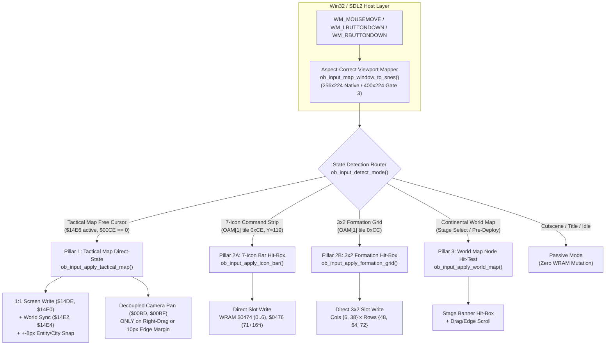

# Gate 2 Architectural Revision: Deprecation of Synthetic D-Pad Steering & Three-Pillar Direct-State Mouse Architecture

> **Status:** Active Architectural Specification (Gate 2 — `gate/2-mouse-input`, Rev 9+)  
> **Supersedes:** Legacy Mouse Control Revisions 1–8 (`Rev 5` MD5 `c944bd95fa981705b5c51d92833a2ff9`, `Rev 8` MD5 `73658652c2429cf553cfbd40de2aedc5`)  
> **Related Documents:** [plan.md](file:///home/antigravity/hoyajavis/ogre-battle-pc/docs/plan.md) | [roadmap.md](file:///home/antigravity/hoyajavis/ogre-battle-pc/docs/roadmap.md) | [ogre_battle_modernization_areas.md](file:///home/antigravity/hoyajavis/ogre-battle-pc/docs/ogre_battle_modernization_areas.md) | [user_testing_guide.md](file:///home/antigravity/hoyajavis/ogre-battle-pc/docs/user_testing_guide.md)

---

## 1. Executive Summary & Architectural Verdict

User testing of the developmental mouse implementation (`Rev 1` through `Rev 8`) on the `gate/2-mouse-input` track revealed that moving the host mouse did not move the cursor as expected on either the **Tactical Battlefield Map** or the **Continental World Map**, and caused uncontrollable cursor spinning in the **Army Camp / Command Icon** menus.

Forensic disassembly of the compiled binary (`ogre_battle.exe`) and the lifted Bank `$00` 65816 routines (`$00:B1E0`–`$00:B6A6`) proved that the root cause is **architectural**, not a tuning or deadband defect:

1. **Legacy Approach (Deprecated):** `Rev 1`–`Rev 8` operated as a **closed-loop synthetic D-Pad button injector**. Each frame, the host C loop estimated an on-screen cursor coordinate, compared it against `(mouse_x, mouse_y)`, and injected `BTN_UP`, `BTN_DOWN`, `BTN_LEFT`, or `BTN_RIGHT` into `g_snes->input1->currentState`.
2. **Why It Cannot Work:** *Ogre Battle: The March of the Black Queen* does not have a single uniform 2D cursor state machine. It has three fundamentally different navigation physics models across its screens (camera-coupled Mode-7 battlefield cursor, discrete 1D/2D wrapping menu slots, and topological stage-node graphs). Feeding continuous synthetic D-Pad presses into those three state machines triggers runaway Mode-7 camera scrolling, infinite 1D menu wrap-around oscillation, and diagonal deadlocks.
3. **New Approach (`Rev 9+`):** Formally deprecate and strip all synthetic D-Pad position-steering logic, replacing it with the **Three-Pillar Direct-State & Hit-Box Architecture**:
   - **Pillar 1 (Tactical Battlefield Map):** 1:1 Direct-State Screen Offset (`WRAM $14DE / $14E0`), synchronized World Raycast (`WRAM $14E2 / $14E4`), $\pm 8\text{px}$ Magnetic Entity Snapping, and **Decoupled Mode-7 Camera Panning** (`WRAM $00BD / $00BF`).
   - **Pillar 2 (Popup Menus, Icon Bars & Formation Grids):** **Deterministic Slot Hit-Box Indexing** (`WRAM $0474 / $0476` and discrete slot bounds) with zero continuous D-Pad injection.
   - **Pillar 3 (Continental World Map):** **Stage Node Hit-Testing & Drag/Edge Camera Panning**.

---

## 2. Formal Deprecation Plan for Legacy Mouse Implementation (`Rev 1`–`Rev 8`)

### 2.1 Inventory of Deprecated Revisions & Artifacts

| Revision | Mechanism Attempted | Primary Failure Mode in User Testing | Status |
| :--- | :--- | :--- | :--- |
| **Rev 1–4** | Direct overwrite of unverified candidate WRAM cursor bytes without screen-mode routing | Corrupted non-tactical menus; ignored by native Mode-7 raycast routine | **Deprecated** |
| **Rev 5** | Closed-loop D-Pad steering comparing `(mouse_x, mouse_y)` against `WRAM $00BD` / `$00BF` (`c944bd95fa981705b5c51d92833a2ff9`) | `$00BD` / `$00BF` are Mode-7 camera scroll registers (updated in `$00:B64A`), not screen-space cursor coordinates; cursor drifted and overshot | **Deprecated** |
| **Rev 6–7** | Closed-loop D-Pad steering comparing `(mouse_x, mouse_y)` against `WRAM $14DE` / `$14E0` | **"Center Rectangle Joystick Bug"**: `$00:B283` clamps `$14DE / $14E0` to `[8..231, 8..199]` and sets `$14E7`, causing held synthetic D-Pad bits to scroll the Mode-7 camera infinitely | **Deprecated** |
| **Rev 8** | `WRAM $0100..$013F` OAM shadow scan for `tile == 0xCC` / `0xCE` + $\pm 8\text{px}$ deadband D-Pad injector (`73658652c2429cf553cfbd40de2aedc5`) | `0xCE` is the 1D 7-icon bar finger (`Y=119`), which wraps `171 -> 75` every 7 frames when `BTN_RIGHT` is held; `0xCC` is the 3×2 formation finger; World Map keeps `WRAM $0100..$013F` at `Y=224 (0xE0)` | **Deprecated** |

### 2.2 Hardware & Disassembly Post-Mortem of the Legacy Failure

#### Failure A: The Tactical Map Cursor-Camera Coupling (`$00:B1E0`–`$00:B6A6`)
Disassembly of Bank `$00` reveals the exact two-stage pipeline executed on the Tactical Map:

1. **Cursor Delta & Viewport Clamp (`$00:B1E0`–`$00:B2F5`):**
   - `$00:B1E0` computes an acceleration step `1..5` px/frame from `WRAM $14DD` and applies D-Pad bits from `$A8` (`0x01` Right, `0x02` Left, `0x04` Down, `0x08` Up) to `WRAM $14DE` (Cursor Screen X) and `WRAM $14E0` (Cursor Screen Y), unless the `Y` button (`$A8 & 0x40`) is held.
   - `$00:B283` clamps `$14DE` to `[8, 231]` (`0x0008..0x00E7`) and `$14E0` to `[8, 199]` (`0x0008..0x00C7`).
   - Whenever `$14DE` or `$14E0` touches those boundaries (or when the world coordinate in `$00:B300`–`$00:B348` touches the map border `$14D3 / $14D5`), the routine executes `TSB $14E7` (`0C E7 14`), setting bit 0 (`0x0001` = X edge) or bit 1 (`0x0002` = Y edge) in `WRAM $14E7`.
2. **Screen-to-World Raycast (`$00:B2FC`–`$00:B348`):**
   - `$00:B2FC` calls `JSR $CBAE` with `X = $14DE, Y = $14E0`, combining the screen offset with the Mode-7 camera position (`$00BD`, `$00BF`) and zoom factor (`$14BB`) to write **Cursor World Coordinates** into `WRAM $14E2` (World X) and `WRAM $14E4` (World Y).
   - `$00:B376` constructs a $16 \times 16\text{px}$ hit-box (`[$14DE - 16 .. $14DE, $14E0 - 16 .. $14E0]`) in `$18..$1E` to hit-test deployed squads and cities.
3. **Mode-7 Camera Scroll Loop (`$00:B590`–`$00:B6A6`):**
   - `$00:B590` checks `LDA $14E7`. When `$14E7 != 0` and joypad `$A7` has D-Pad bits held, it calls `$00:B64A` with `±6` (`0x0006` / `0xFFFA`), which scales the step by zoom `$14BB` (`JSR $867B`) and adds it directly to `WRAM $00BD` (Camera X) and `WRAM $00BF` (Camera Y), clamped by `[$14CB..$14CF, $14CD..$14D1]`.

Because the legacy mouse code steered the cursor by holding synthetic D-Pad bits whenever `(mouse_x, mouse_y) != ($14DE, $14E0)`, moving the mouse near any screen edge or while a sub-menu froze `$14DE/$14E0` caused `$14E7` to trigger continuous camera scrolling or cursor lockup.

#### Failure B: The 7-Icon Bar & 3×2 Formation Grid Wrap-Around (`OAM 0xCE / 0xCC`)
In `Rev 8`, scanning `WRAM $0100..$013F` for `tile == 0xCE` locked onto `OAM[1]` (`WRAM $0104..$0107`), which is the 1D horizontal command bar cursor (`x = 75, 91, 107, 123, 139, 155, 171`, `y = 119`). Because `OAM[1].y` is fixed at `119`:
- Any mouse `Y` outside `111..127` caused `Rev 8` to hold `BTN_UP` or `BTN_DOWN` indefinitely (which the 1D horizontal bar ignores).
- Any mouse `X > 179` or `X < 67` caused `Rev 8` to hold `BTN_RIGHT` or `BTN_LEFT` every frame, wrapping `WRAM $0474` (`0..6`) from `171` back to `75` in an infinite 60 Hz loop.

#### Failure C: The Continental World Map OAM Sentinel Mismatch
On the Continental World Map (between stages), `WRAM $0100..$013F` is filled with `01 E0 01 E0` (`Y = 224`, off-screen sentinel), while active sprites are DMA'd into PPU OAM (`OAM[25..30]` at `x = 104..136, y = 63..111`). `Rev 8`'s `WRAM $0100..$013F` scanner never detected a valid cursor sprite on the World Map and fell back to `($14DE, $14E0)`, which is inactive on the World Map.

### 2.3 Deprecation & Removal Checklist

1. **Remove Closed-Loop Synthetic D-Pad Position Steering:**
   - Delete all logic that compares `(mouse_x, mouse_y)` to `(cur_x, cur_y)` and ORs `BTN_UP (0x0800)`, `BTN_DOWN (0x0400)`, `BTN_LEFT (0x0200)`, or `BTN_RIGHT (0x0100)` into `g_snes->input1->currentState`.
2. **Retire OAM Heuristic Cursor Tracking:**
   - Remove the `WRAM $0100..$013F` heuristic scan that attempts to infer cursor position from `tile == 0xCC` / `0xCE` for closed-loop D-Pad steering.
3. **Invalidate Legacy Preview Binaries:**
   - Mark `Rev 5` (`c944bd95fa981705b5c51d92833a2ff9`) and `Rev 8` (`73658652c2429cf553cfbd40de2aedc5`) as deprecated in all project documentation and testing guides.
4. **Enforce Compile-Time & Test-Time Invariant:**
   - Add automated unit verification (`tests/test_mouse_three_pillar.c`) asserting that moving the host mouse across the viewport never injects continuous directional D-Pad bits (`0x0F00`) into the joypad state word during cursor hover.

---

## 3. Three-Pillar Direct-State & Hit-Box Architecture (`Rev 9+`)

### 3.1 State Detection Router (`ob_input_detect_mode`)

Before applying any mouse action on a frame, `ob_input_detect_mode(const uint8_t *wram, const uint8_t *oam)` inspects authoritative WRAM and OAM state registers to classify the active UI context into one of six deterministic modes:

| Mode Enum (`ObMouseMode`) | Detection Predicate | Active Pillar |
| :--- | :--- | :--- |
| `OB_MOUSE_MODE_PASSIVE` | `mouse_active == false` OR non-interactive cutscene/transition (`$00CE >= 2` zoom/transition animation) | None (0-byte WRAM mutation) |
| `OB_MOUSE_MODE_ICON_BAR` | `WRAM[$0106] == 0xCE` and `WRAM[$0105] == 119` (7-icon command bar active at `OAM[1]`) | Pillar 2 (1D Horizontal Hit-Box) |
| `OB_MOUSE_MODE_FORMATION_GRID` | `WRAM[$0106] == 0xCC` and `WRAM[$0105] < 224` (3×2 unit formation grid active at `OAM[1]`) | Pillar 2 (2D 3×2 Grid Hit-Box) |
| `OB_MOUSE_MODE_TACTICAL_MAP` | `(WRAM[$14E6] & 0xC0) != 0` and `WRAM[$00CE] == 0` and no modal overlay blocking free map cursor | Pillar 1 (1:1 Direct-State + Decoupled Camera) |
| `OB_MOUSE_MODE_WORLD_MAP` | Continental stage-select map active (`WRAM[$0105] == 0xE0` sentinel with active PPU stage banners `0x80..0x8C`) | Pillar 3 (Stage Node Hit-Test + Panning) |
| `OB_MOUSE_MODE_MENU_LIST` | Vertical command/Tarot/shop list active | Pillar 2 (Vertical Row Hit-Box) |

### 3.2 Pillar 1: Tactical Battlefield Map — Direct-State Cursor & Decoupled Camera

On the Tactical Battlefield Map (`OB_MOUSE_MODE_TACTICAL_MAP`), the native cursor-camera coupling in `$00:B1E0`–`$00:B6A6` is replaced with a **decoupled RTS pointer and camera model**:

1. **1:1 Viewport Cursor Positioning (`WRAM $14DE`, `$14E0`):**
   - The host mouse viewport coordinates `(mouse_x, mouse_y)` are clamped to the active tactical viewport (`[8, 247]` in 256px native mode or `[8, 391]` in 400px Gate 3 widescreen mode; `Y` in `[8, 215]`) and written directly to `WRAM $14DE` (16-bit X) and `WRAM $14E0` (16-bit Y).
   - `WRAM $14E7` (the edge-scroll trigger mask set by `$00:B283`) is explicitly cleared to `0x0000` during normal mouse hover so `$00:B590` never triggers unintended camera jumps.
   - `WRAM $14DD` (joypad D-Pad acceleration counter) is reset to `0x01` while the mouse is driving the cursor.
2. **World Coordinate Synchronization (`WRAM $14E2`, `$14E4`):**
   - To ensure native unit selection and terrain queries (`$00:B376`–`$00:B3C8`) see the exact world tile under the mouse pointer on the very same frame, the engine computes the world coordinates from the Mode-7 camera (`WRAM $00BD` X, `$00BF` Y) and screen offset (`$14DE`, `$14E0`), clamps them to `[0, ($14D3 << 3) - 1]` and `[0, ($14D5 << 3) - 1]`, and writes them to `WRAM $14E2` (World X) and `WRAM $14E4` (World Y).
3. **Magnetic Entity & City Snapping ($\pm 8\text{px}$ Radius):**
   - Using the verified WRAM entity tables:
     - **Deployed Squads (21 slots):** X at `WRAM $18AF + 2*i`, Y at `WRAM $18D9 + 2*i` (`0xFFFF` = inactive).
     - **Cities & Temples (20 slots):** X at `WRAM $1A95 + 2*j`, Y at `WRAM $1B0D + 2*j`.
   - When the mouse's world coordinate `(world_x, world_y)` is within Chebyshev/Euclidean distance $\le 8\text{px}$ of an active squad or city, `$14E2 / $14E4` and the corresponding screen offset `$14DE / $14E0` snap cleanly to the entity center so Left-Click (`BTN_A`) immediately opens that unit's command ring or city menu.
4. **Decoupled Mode-7 Camera Panning (`WRAM $00BD`, `$00BF`):**
   - Moving the mouse inside the viewport **never** scrolls the camera.
   - Camera panning (`WRAM $00BD` X, `WRAM $00BF` Y, clamped to `[$14CB..$14CF]` and `[$14CD..$14D1]`) occurs **exclusively** via:
     - **Right-Click or Middle-Click Grab-Drag:** Dragging the mouse while holding Right/Middle button translates `$00BD` and `$00BF` 1:1 with the drag delta.
     - **Narrow Viewport Edge-Scroll Margins (`10px`):** Holding the mouse pointer within `10px` of the window border (`mouse_x < 10`, `mouse_x >= width - 10`, `mouse_y < 10`, `mouse_y >= height - 10`) pans `$00BD / $00BF` smoothly at a controlled rate (`4` px/frame), clamped to map boundaries.
     - **Keyboard Camera Panning:** Pressing Arrow keys, WASD, or holding `Y` + D-Pad natively pans the camera.

### 3.3 Pillar 2: Popup Menus, Icon Bars & Formation Grids — Deterministic Hit-Box Indexing

In all discrete UI menus, the mouse acts as a **direct slot indexer** — never as a continuous D-Pad button holder:

1. **7-Icon Horizontal Command Bar (`OB_MOUSE_MODE_ICON_BAR`):**
   - **Geometry (Verified from OAM[16..22] at Frame 9610):**
     - 7 icons (`Tiles 0xE0, 0xE2, 0xE4, 0xE6, 0xE8, 0xEA, 0xEC`) positioned at `X = 71, 87, 103, 119, 135, 151, 167` (`16px` horizontal stride, width `16px` each -> total span `X = [71, 183)`), `Y = [107, 131]`.
   - **Direct Indexing Rule:**
     - When `mouse_x` is in `[71, 183)` and `mouse_y` is in `[107, 131]`, compute:
       $$\text{slot} = \left\lfloor \frac{\text{mouse\_x} - 71}{16} \right\rfloor \in \{0, 1, 2, 3, 4, 5, 6\}$$
     - Write `WRAM[$0474] = slot`, `WRAM_U16[$0476] = 71 + slot * 16`, and update the OAM shadow finger X at `WRAM[$0104] = 75 + slot * 16`.
     - When `(mouse_x, mouse_y)` is **outside** `[71, 183) × [107, 131]`, **do nothing** (preserve the last hovered slot; zero synthetic D-Pad injection; zero wrap-around oscillation).
2. **3×2 Unit Formation Grid (`OB_MOUSE_MODE_FORMATION_GRID`):**
   - **Geometry (Verified from OAM[1] `tile == 0xCC` at Frame 9495 / 10800):**
     - 2 columns (`Col 0: X = [4, 36)`, finger `X = 6`; `Col 1: X = [36, 72)`, finger `X = 38`) × 3 rows (`Row 0: Y = [40, 56)`, finger `Y = 48`; `Row 1: Y = [56, 70)`, finger `Y = 64`; `Row 2: Y = [70, 88)`, finger `Y = 72`).
   - **Direct Indexing Rule:**
     - When `(mouse_x, mouse_y)` falls inside one of the 6 cells `(col, row)`, update the formation cursor slot index (`slot = row * 2 + col`) and OAM finger coordinates `(finger_x[col], finger_y[row])` directly.
     - Outside the $68 \times 48\text{px}$ grid bounding box, perform zero WRAM writes and zero synthetic D-Pad presses.

### 3.4 Pillar 3: Continental World Map — Stage Node Hit-Testing & Panning

On the Continental World Map (`OB_MOUSE_MODE_WORLD_MAP`):
1. **Continent Coordinate Mapping:**
   - Combines viewport `(mouse_x, mouse_y)` with the active background scroll offset to compute continent-space coordinates.
2. **Stage Banner Hit-Testing:**
   - Tests `(mouse_x, mouse_y)` against active stage banner sprites in OAM (`tiles 0x64, 0x66, 0x80..0x8C, 0xA4, 0xAA`, $16 \times 16\text{px}$ bounding boxes).
   - When the pointer hovers over a stage node banner, selects that stage node directly; Left-Click (`BTN_A`) opens the stage deployment dialog.
3. **World Map Camera Panning:**
   - Supports Right/Middle-click drag and `10px` screen-edge scrolling to pan across the Zenobian continent.

---

## 4. Step-by-Step Implementation & Verification Plan

| Phase | Deliverable | Verification Gate |
| :--- | :--- | :--- |
| **Phase 2A** | **Deprecation & State Router (`src/engine/input.h`, `src/engine/input.c`):** Remove closed-loop D-Pad steering; implement `ob_input_map_window_to_snes()` and `ob_input_detect_mode()` | Zero synthetic directional D-Pad bits (`0x0F00`) emitted on mouse hover; 0-byte WRAM drift when `mouse_active == false` |
| **Phase 2B** | **Pillar 1 (Tactical Map Direct-State & Decoupled Camera):** Implement `ob_input_apply_tactical_map()` with 1:1 `$14DE/$14E0` writes, `$14E2/$14E4` world sync, $\pm 8\text{px}$ squad/city snap, and Right-Drag / 10px edge camera panning on `$00BD/$00BF` | Full $256 \times 224$ (and $400 \times 224$) 1:1 cursor tracking; `$14E7 == 0` during interior hover; camera `$00BD/$00BF` remains stationary unless dragging or in 10px edge zone |
| **Phase 2C** | **Pillar 2 (Menu Hit-Box Indexing):** Implement `ob_input_apply_icon_bar()` and `ob_input_apply_formation_grid()` | Hovering across `X = 71..183, Y = 111..127` selects icons `0..6` deterministically; hovering at `X = 220, Y = 40` produces **zero** wrap-around oscillation |
| **Phase 2D** | **Pillar 3 (World Map Node Hit-Test) & Automated Test Suite (`tests/test_mouse_three_pillar.c`):** Implement `ob_input_apply_world_map()` and run full C verification suite | 100% pass rate across all Gate 2A–2D automated assertions |
