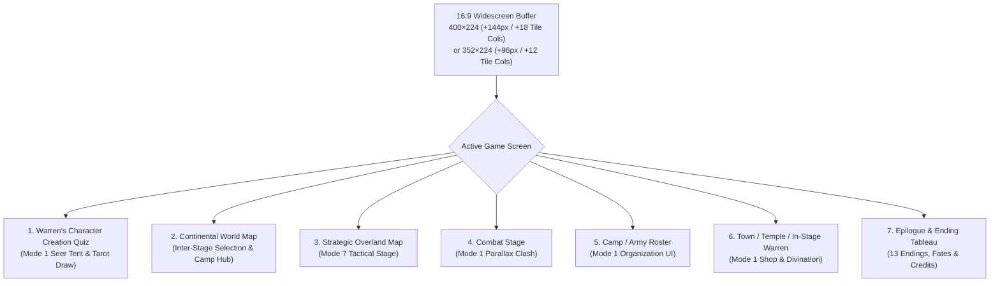
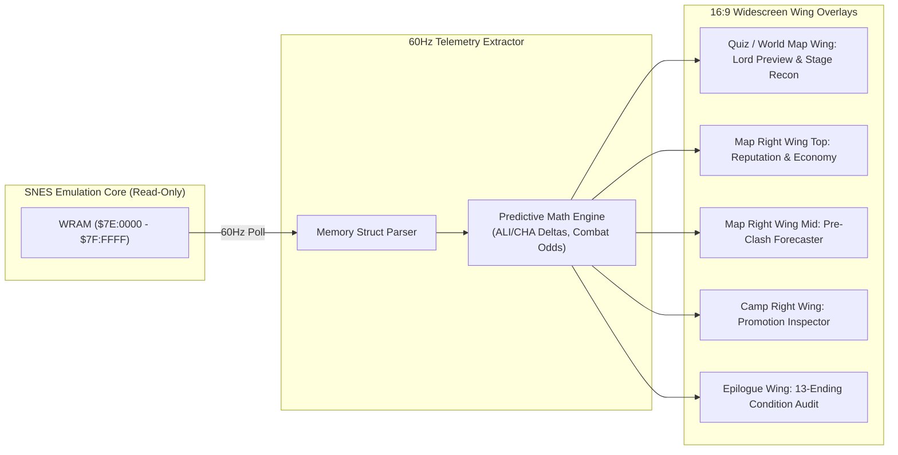
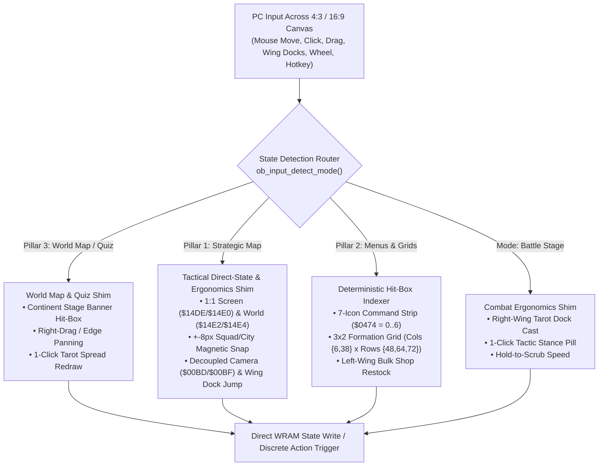
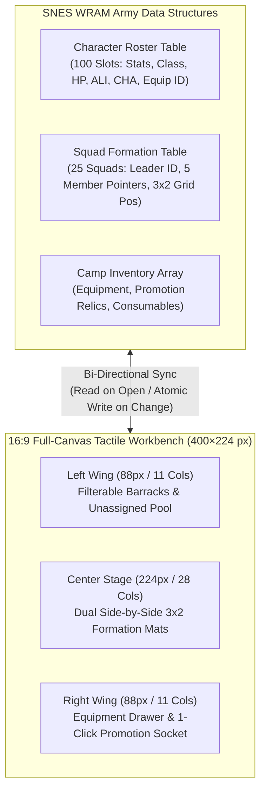
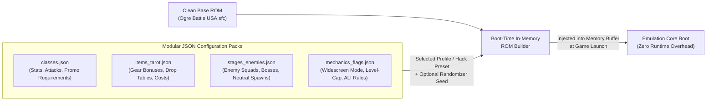

# Architecture Exploration: Modernizing *Ogre Battle (1993)* via Non-Destructive Shims & Widescreen Viewport Expansion

This document explores the core architectural pillars designed to bridge Quest's 1993 Super NES masterpiece (*Ogre Battle: The March of the Black Queen*) with 2026 PC strategy ergonomics. Each pillar operates on the principle of **preserving the authentic 65816 simulation engine** while expanding the viewport from 4:3 to 16:9 and intercepting memory (WRAM), input registers, or boot-time ROM tables to elevate the experience for Purists (Profile A), Modern Tacticians (Profile B), and Modders/Randomizer Runners (Profile C).

---

## Foundation: The 4:3 to 16:9 Widescreen Viewport & Tile Math

Expanding an SNES title from its native 1993 viewport to a modern 16:9 widescreen aspect ratio requires addressing two distinct mathematical baselines—because the SNES outputs an internal pixel grid of **256 × 224** (an internal pixel ratio of `8:7`), which a 1993 CRT television stretched horizontally by a `8:7` (`~1.143x`) pixel aspect ratio (PAR) to fill a physical `4:3` (`1.333:1`) screen.

Maintaining the native vertical height of **224 pixels (28 tiles of 8×8 px)** ensures 1:1 vertical scanline integrity for sprites, scanline interrupts (HDMA), and text boxes. All expansion occurs horizontally:

### 1. Exact Pixel & Tile Delta Calculations

| Metric | Original Internal Buffer (8:7 Square Pixels) | Method A: 16:9 Square-Pixel Expansion (1:1 PAR) | Method B: 16:9 CRT-Authentic Expansion (8:7 PAR) |
| :--- | :--- | :--- | :--- |
| **Vertical Height** | `224 px` (`28 tiles` @ 8×8) | `224 px` (`28 tiles` @ 8×8) | `224 px` (`28 tiles` @ 8×8) |
| **Exact 16:9 Width** | `256 px` (`32 tiles` @ 8×8) | $224 \times \frac{16}{9} = 398.22\text{ px}$ | $256 \times \frac{16/9}{4/3} = 256 \times \frac{4}{3} = 341.33\text{ px}$ |
| **Tile-Aligned Width (8×8 Grid)** | **256 px** (`32 tiles`) | **400 px** (`50 tiles`) | **352 px** (`44 tiles`) *(or **336 px** / `42 tiles`)* |
| **Horizontal Pixel Gain ($\Delta X$)** | Baseline | **+144 px** (`+72 px` Left / `+72 px` Right) | **+96 px** (`+48 px` Left / `+48 px` Right) |
| **Horizontal 8×8 Tile Gain** | Baseline (`32 cols`) | **+18 Tile Columns** (`+9 cols` per side) | **+12 Tile Columns** (`+6 cols` per side) |
| **Horizontal 16×16 Metatile Gain** | Baseline (`16 cols`) | **+9 Metatile Columns** (`+4.5` per side) | **+6 Metatile Columns** (`+3` per side) |
| **Total Framebuffer Pixels** | `57,344 px` | `89,600 px` (**+32,256 px** / **+56.25%**) | `78,848 px` (**+21,504 px** / **+37.5%**) |
| **Total 8×8 Tiles on Screen** | `896 tiles` (`32 × 28`) | `1,400 tiles` (`50 × 28`, **+504 tiles**) | `1,232 tiles` (`44 × 28`, **+336 tiles**) |

> [!IMPORTANT]
> **Recommended Engine Target:** **400 × 224 (`50 × 28` tiles)** for crisp square-pixel PC rendering (scales cleanly by $4\times$ to `1600×896` or $4.8\times$ to `1920×1080`), giving **+144 horizontal pixels (+72 px / +9 tiles on both the Left and Right margins)**. If CRT non-square pixel aspect correction is toggled on for Profile A Purists, the internal buffer renders at **352 × 224 (`44 × 28` tiles)**, providing **+96 horizontal pixels (+48 px / +6 tiles on each side)**.

```
                       400 × 224 WIDESCREEN VIEWPORT (50 × 28 Tiles)
┌──────────────────┬───────────────────────────────────────────────────┬──────────────────┐
│   LEFT WING      │              ORIGINAL 4:3 CORE AREA               │    RIGHT WING    │
│  +72 px Wide     │                   256 × 224 px                    │   +72 px Wide    │
│  (9 × 28 Tiles)  │                 (32 × 28 Tiles)                   │  (9 × 28 Tiles)  │
│                  │                                                   │                  │
│  252 New Tiles   │                 896 Original Tiles                │   252 New Tiles  │
│ (+16,128 Pixels) │                  (57,344 Pixels)                  │ (+16,128 Pixels) │
└──────────────────┴───────────────────────────────────────────────────┴──────────────────┘
```

---

### 2. Screen-by-Screen Real Estate Allocation: (1) Vanilla vs. (2) Modernized

Every distinct screen in *Ogre Battle* uses different SNES PPU background modes (Mode 7 for the overland tactical map and continental world map, Mode 1 for combat, camp, Warren's tent, and the epilogue). Below is how the extra **+144 pixels (+18 tile columns)**—or **+96 pixels (+12 tile columns)** in CRT-aspect mode—are utilized across every game screen under **(1) Vanilla Widescreen** vs. **(2) Modernized Feature Mode**.



#### Screen 1: Warren's Character Creation Tarot Quiz (Opening Seer Tent)
At the beginning of a campaign, Warren draws 6 random Major Arcana Tarot cards from the 22-card deck, asks the player a moral/philosophical question for each card, and asks them to pick a final 7th card—secretly determining the Opinion Leader's starting Class variant/attack element (`Fire`, `Ice`, `Thunder`, `Phantom`), base stats (`HP`, `STR`, `AGI`, `INT`, `CHA`, `ALI`, `LUCK`), and initial Chaos Frame.
* **(1) Vanilla Game in 16:9:**
  * **Expanded Seer's Sanctum Backdrop:** In the original `256 × 224` screen, the 6 drawn Tarot cards sit in a tight horizontal row above Warren and the crystal table, while question text boxes overlap the bottom. In Vanilla 16:9 (`400 × 224`), the candlelit tent tapestry and starry dark backdrop extend across the extra **+18 tile columns (+72 px per side)**, and the 6 Tarot cards are spaced with generous breathing room so their pixel art is never cramped.
  * **Title Screen Pre-Quiz Transition:** Before entering Warren's tent, the Title Screen flyover expands the starry night sky and Mode-7 map scroll across the full 400 px width.
* **(2) With Modernization Features Implemented:**
  * **Left Wing (`X: 0..71` — 9 × 28 Tiles): Boot-Time Mod, Rule & Seed Configurator (Area 4):**
    * Allows the player to configure campaign-level JSON manifests *while sitting at Warren's table* before locking in their character:
      * Toggle community ROM hack presets (Class Rebalance, Hard Mode Enemy Squads), set QoL flags (`Disable Overlevel ALI Penalty`, `Positive Temple Draws`), or input a **Randomizer Seed**.
      * Includes a **"Re-Draw 6 Tarot Cards"** button (Input Injection, Area 2) so players don't have to soft-reset the console to get specific starting cards in their 6-card spread.
  * **Right Wing (`X: 328..399` — 9 × 28 Tiles): Live Lord Archetype & Stat Telemetry (Area 1):**
    * In 1993, players had no idea which quiz answers gave them the coveted **Ice/Fire/Slash** Lord (2 front attacks + 1 back AoE magic attack) vs. the **Phantom** or **Leader-Heal** Lord.
    * As the player highlights Answer A, B, or C for each Tarot question, the Right Wing dynamically previews the cumulative effect on the Opinion Leader:
      * **Live Stat Tallies:** `STR: 54 (+2)`, `INT: 51 (+3)`, `ALI: 62 (-4)`, `CHA: 58 (+1)`, `Starting CF: 56`.
      * **Projected Lord Class Variant:** Explicitly displays the resulting Lord attack pattern (`Front: 2× Ice Slash | Back: 1× Ice Storm AoE`) and growth curve before the final 7th card is confirmed.

#### Screen 2: The Inter-Stage Continental World Map (Stage Selection & Army Hub)
Between tactical battles, the player views the grand **Continental Map of Zenobia (Avalon to Shalina)**, watching liberation banners spread across conquered territories, selecting the next stage node, or opening the Camp/Save menus.
* **(1) Vanilla Game in 16:9:**
  * **Panoramic Continental View:** The continental parchment/terrain map of Zenobia is stored in VRAM as a scrolling background plane larger than `256 × 224`. Expanding the viewport to `400 × 224` (+144 px) reveals nearly **56% more of the continent at once**, letting the player see branching campaign routes (e.g., the northern *Kastolatian Sea / Balmorian Ruins* route vs. the southern *Pogrom Forest / Deneb's Garden* route) in a single panoramic frame without camera panning.
* **(2) With Modernization Features Implemented:**
  * **Left Wing (`X: 0..71` — 9 × 28 Tiles): Campaign Route & Army Readiness Summary (Area 1 & Area 3):**
    * Displays global campaign telemetry: Total Treasury (`Goth`), Total Roster Count (`68/100 Units`), Squads Ready (`12/25`), and a **1-Click "Enter Tactile Roster Workbench"** button (Area 3) plus a warning badge if any squad has dead/unhealed units or unpromoted characters before you launch a stage.
    * Shows **Revisitable Stage Indicators** (listing which liberated stages have new merchant stock, neutral monster recruits, or unresolved quest triggers like *Slust*, *Fenril*, or *Galf*).
  * **Right Wing (`X: 328..399` — 9 × 28 Tiles): Stage Intelligence Dossier (Area 1 & Area 4):**
    * Hovering the mouse cursor (Area 2) over any stage node on the Continental Map populates a rich **Stage Dossier Card** in the Right Wing:
      * **Enemy Force Recon:** Boss Name & Level (e.g., *Debonair — Lvl 15 General*), Average Enemy Squad Level (`Lvl 11–13`), Recommended Army Level (to avoid over-leveling ALI penalties), and primary enemy elemental weaknesses.
      * **Cartography & Secret Checklist:** Displays stage completion tracking—`Towns: 9`, `Temples: 3`, `Buried Treasures Found: 2/4`, and `Key Story Triggers` (e.g., *"Bring Posse/Tristan for secret dialogue"* or *"Requires Chaos Frame > 65 for peaceful recruitment"*).

#### Screen 3: The Strategic Overland Map (Mode 7 Tactical Deployment)
* **(1) Vanilla Game in 16:9:**
  * **Extended Mode-7 Scanline Rendering:** Because Mode 7 calculates affine transformations (`M7A`, `M7B`, `M7C`, `M7D`) per pixel across each scanline, extending the horizontal scanline counter from `256` to `400` (or `352`) naturally renders **+72 px (9 tiles) of additional map terrain on both the left and right edges** with zero distortion.
  * **HDMA Sky & Cloud Extension:** The upper horizon strip (rendered via BG2/BG3 tilemaps above the Mode-7 split scanline) loops smoothly across the extra 18 tile columns, while the OAM sprite clipping threshold (`X < 0` or `X > 255`) is widened to `0..399` so enemy squads, towns, and flying units remain visible across the full peripheral field of view.
  * **HUD Repositioning:** The native top-right Day/Time/Goth box and bottom-left Unit Status box are pushed outward to anchor flush with the new `X = 0` and `X = 399` screen edges, freeing up the central `256×224` focal area completely.
* **(2) With Modernization Features Implemented:**
  * **Left Wing (`X: 0..71` — 9 × 28 Tiles):** Houses the **Interactive Deployed Squad Dock** (Area 2). Up to 10 deployed squads are listed vertically in compact `72 × 20 px` tactical plates showing Leader Portrait, Squad HP bar, active order icon (`Moving`, `Resting`, `Patrolling`), and hotkey badge (`1–0`). Clicking any plate snaps the camera to that unit.
  * **Right Wing (`X: 328..399` — 9 × 28 Tiles):** Houses the **Zero-Invasion Telemetry & Pre-Clash Forecaster** (Area 1):
    * *Top Block (`72 × 56 px`):* Exact **Chaos Frame** gauge (`0–100`), Noon Goth Tribute net balance (`+14,200 G`), and Stage Liberation counter (`8/11 Towns`).
    * *Middle Block (`72 × 112 px`):* **Live Pre-Clash Forecaster** when hovering over an enemy squad—displaying predicted win/loss damage bars and warning badges for any character risking `-ALI` or `-CHA` penalties.
    * *Bottom Block (`72 × 56 px`):* **Mini-Radar & Speed Scrubber** (`0.5x / 1x / 2x / 4x` time controls + hidden treasure proximity indicator).

#### Screen 4: The Combat Stage Screen (Autobattle Clash)
* **(1) Vanilla Game in 16:9:**
  * The original combat stage renders on a `256 × 224` canvas where BG1 draws the isometric battle platform and BG2 draws the scrolling parallax background (forests, castle walls, clouds).
  * In Vanilla 16:9, BG2’s 64×32 tilemap buffer already exists in VRAM (`$7F` / PPU VRAM), so expanding the viewport immediately reveals **+9 tiles per side of authentic background scenery**.
  * The isometric combat stage edges are extended by 3 metatiles on each side so knockback animations and sweeping spell effects (*Tornado*, *Meteor*, *Jihad*) do not clip abruptly at the old 4:3 border.
* **(2) With Modernization Features Implemented:**
  * **Left Wing (`X: 0..71` — 9 × 28 Tiles):** **Live Combat Telemetry & Turn Queue** (Area 1):
    * Displays the real-time **Initiative & Action Order Bar** (sorted by unit `AGI` and remaining attacks: e.g., `1. Ninja (2x) -> 2. Enemy Wizard (1x) -> 3. Knight (2x)`).
    * Shows live floating **ALI / CHA Delta Trackers** whenever a unit lands a killing blow, plus elemental resistance icons (`Physical`, `Fire`, `White`, `Black`) for the targeted enemy squad.
  * **Right Wing (`X: 328..399` — 9 × 28 Tiles):** **Tactical Command & Tarot Grimoire Dock** (Area 2):
    * *Top Section:* Four 1-click **Tactic Stance Pills** (`[Q] Leader`, `[W] Strong`, `[E] Weak`, `[R] Best`) and a hold-to-fast-forward speed toggle.
    * *Main Section:* A scrollable vertical fan of the player's **Held Tarot Cards**. Instead of pausing the battle and navigating a blind text list, the player sees each card's artwork and damage/effect preview (`The Chariot: +STR`, `The Empress: Full Heal`) and can cast it in a single click.

#### Screen 5: Camp / Unit Organization & Army Roster
* **(1) Vanilla Game in 16:9:**
  * Because the vanilla camp menus are built on fixed 32-tile-wide BG1/BG3 tilemaps (`256 px`), Vanilla 16:9 centers the original `256 × 224` menu window and fills the Left and Right `+72 px` wings with a seamless, period-accurate **Zenobian Stone & Parchment Tapestry border** (drawn from existing camp tile palettes), eliminating black bars while keeping classic D-Pad navigation intact.
* **(2) With Modernization Features Implemented:**
  * The entire `400 × 224` (`50 × 28` tiles) canvas becomes the **Unified Tactile Roster Workbench** (Area 3), eliminating nested sub-screen transitions:
    * **Left Wing (`X: 0..87` — 11 Tiles):** **Filterable Barracks & Unassigned Unit Pool** (sortable by Class, Level, `ALI`, or Size).
    * **Center Stage (`X: 88..311` — 28 Tiles):** **Dual 3×2 Squad Formation Mats** displayed side-by-side so players can drag-and-drop characters directly between Squad A and Squad B while watching front/back row attack changes, unit size shifts, and leadership auras update in real time.
    * **Right Wing (`X: 312..399` — 11 Tiles):** **Equipment & Promotion Inspector**—combining the Camp Item Drawer (drag relics/weapons onto units with instant green/red stat diffs) and the **Class Promotion Checklist** (Area 1 & Area 3) in a single persistent panel.

#### Screen 6: Town Shops, Temple Tarot Draws, and In-Stage Warren Seer Menu
* **(1) Vanilla Game in 16:9:**
  * Extends the town/temple scenic background art across the wider viewport and shifts character dialogue portraits slightly outward so text boxes never obscure speaker artwork.
* **(2) With Modernization Features Implemented:**
  * **Town Shop Screen:** The center `256 px` displays the merchant and item list, while the **Left Wing (`+72 px`)** shows your **Current Camp Inventory Stock & Bulk Restock Buttons** (`+1 / +5 / Restock Kit`) and the **Right Wing (`+72 px`)** displays **Squad Equipment Compatibility** (showing which deployed leaders can equip the highlighted weapon and their stat gain).
  * **Temple Tarot Draw:** When liberating a temple, the **Right Wing (`+72 px`)** displays the **Tarot Dual-Outcome Card**—comparing the exact stat/ALI change if absorbed right now vs. its combat spell effect if added to your deck, alongside any Boot-Time Rule Toggles active (Area 4, such as *Positive-Only Temple Draws*).
  * **Warren's Seer & Chronicle Screen:** Uses the extra **18 tile columns** to render an interactive **Relationship & Rumor Web** alongside Warren's text, cross-referencing hidden character recruitment flags (e.g., showing that visiting *Kastolatian Sea* with *Tristan* unlocks a secret dialogue event).

#### Screen 7: The Epilogue, Ending Tarot Tableau & Post-Campaign Chronicle
*Ogre Battle* is famous for its **13 distinct endings** (*The World*, *The Sun*, *Judgement*, *The Star*, *The Empress*, *The Hierophant*, *Justice*, *Temperance*, *Chariot*, *The Emperor*, *The Hanged Man*, *The Tower*, and *The Devil*), determined by a complex web of final Chaos Frame, Opinion Leader Alignment, whether Tristan/Rauny/Debonair/Yushis were recruited, and whether the Holy Sword *Brunhild* and the 3 Mystical Gems were gathered.
* **(1) Vanilla Game in 16:9:**
  * **Cinematic Epilogue Vignettes:** During the post-final-boss castle sequences, character farewell scenes, and the Mode-7 airship/horseback credits roll, the viewport opens to the full `400 × 224` width, letting the sweeping Mode-7 horizon and Sakimoto's *back to the original* orchestral finale play across an uncropped 16:9 stage.
  * **Full-Spread Final Tarot Tableau:** When the game reveals the player's final Ending Tarot Card (e.g., *THE WORLD*), the surrounding celestial tapestry expands across all 50 tile columns.
* **(2) With Modernization Features Implemented:**
  * **Left Wing (`X: 0..71` — 9 × 28 Tiles): Ending Condition Breakdown & "Why You Got This Ending" Audit (Area 1):**
    * Displays the exact final state flags read from WRAM that triggered this specific ending out of the 13 possibilities (e.g., `Final CF: 84 [Req: >80 ✓]`, `Leader ALI: 91 [Req: >65 ✓]`, `Tristan Alive & Recruited: [✓]`, `12 Apostles Sealed: [✓] -> Result: THE WORLD`).
    * Also shows the **"Nearest Alternate Ending"** condition (e.g., *"Without Tristan, these stats would have yielded THE SUN ending"*), giving huge replay value to both Tacticians (Profile B) and Purists (Profile A).
  * **Right Wing (`X: 328..399` — 9 × 28 Tiles): Campaign Hall of Fame, MVP Ledger & Seed Verification (Area 1 & Area 4):**
    * **Squad & Character Epilogue Ledger:** As each special character (Lans, Canopus, Ashe, Lyon, Rauny, Gilbert, Saradin) walks onto the stage during the epilogue roll call, the Right Wing displays their personal campaign stats: Battles Fought, Bosses Slain, Starting vs. Ending Class, and survival status.
    * **Randomizer & Mod Verification Stamp (Profile C):** At the final screen, generates a shareable **Campaign Chronicle Card** containing the exact completion time, Boot-Time Mod Manifest hash, Randomizer Seed string, and victory conditions—ideal for speedrunners and randomizer tournament verification.

---

## Area 1: The "Zero-Invasion" Telemetry Layer

### Concept & Architectural Mechanism
The 1993 original stores its entire runtime state within the SNES 128KB Work RAM (`$7E:0000` to `$7F:FFFF`). Many of the game's most celebrated—and frustrating—systems rely on variables that are completely hidden from the player or buried beneath four layers of nested menus.

A **Zero-Invasion Telemetry Layer** is a strictly read-only memory watcher polling WRAM at 60Hz (on VBlank). It extracts live state variables and renders them primarily inside the **+72 px Left/Right Widescreen Wings** (or as lightweight hover tooltips) without writing a single byte back to the emulator core.



### Extractable WRAM State & Overlay Applications

#### 1. Moral & Macro-State Telemetry (The Reputation HUD)
In the vanilla game, the **Chaos Frame** (0–100) is hidden behind a coarse graphic meter in Warren’s menu, yet single-point thresholds dictate story branches, special character recruitment (e.g., Debonair, Galf, Brunhild), and the 13 distinct endings.
* **Extractable Data:**
  * Exact Chaos Frame integer (`0–100`) and fractional/sub-point accumulation.
  * Current Time-of-Day clock (`00:00–24:00`) and Day counter (tracking daily tribute cutoff at `12:00` Noon).
  * Real-time Goth treasury vs. projected **Active Deployment Drain** (summing the deployment fee of all currently active squads on the map).
* **Overlay Presentation (Right Widescreen Wing — Top `72 × 56 px`):**
  * **The Heraldic Top Box:** Displays exact Chaos Frame alongside a "Next Threshold" tooltip (e.g., *"CF: 68 — +2 needed for High-Reputation Temple Liberation dialogue"*).
  * **Noon Tribute Balance Forecast:** Shows net Goth income (`Liberated Town Tribute - Deployed Unit Upkeep`) so players know prior to noon whether their treasury will grow or go bankrupt.

#### 2. Pre-Clash Alignment (ALI) & Charisma (CHA) Drift Forecaster
The single largest pain point for both Purists and Modern Tacticians is *Ogre Battle*'s opaque Alignment and Charisma math. Killing an enemy unit that is lower level—or killing a high-ALI "holy" unit like a Cleric with a Knight—can tank a character's ALI, permanently locking them out of Paladins/Samurai and forcing them into evil classes.
* **Extractable Data:**
  * Attacker and Defender squad rosters: Individual character Level, current ALI (`0–100`), current CHA (`0–100`), Class ID, and current HP.
  * Terrain type at the point of collision (`Plains`, `Forest`, `Mountain`, `City`, `Sky`) and current Time of Day (which modifies Undead/Werewolf/Demon stats).
* **Overlay Presentation (Right Widescreen Wing — Middle `72 × 112 px`):**
  * **The Engagement Forecast Panel:** When a player selects a friendly squad and hovers the mouse over an enemy squad, the Right Wing panel populates with the exact mathematical consequences of engagement without obscuring the central map:
    * **Kill Delta Preview:** Lists each friendly unit and flags potential penalties (e.g., *"Lans (Lvl 12 Knight) vs. Enemy Cleric (Lvl 9): Kill will cause **-6 ALI / -4 CHA**"*).
    * **Combat Outcome Distribution:** Runs a fast deterministic formula check using the current RNG seed to display expected damage dealt/received, stun/petrify risks, and likely squad pushback vector.

#### 3. Unit Growth & Promotion Readiness Inspector
In 1993, checking why a Fighter cannot promote into a Ninja or Beast Master requires cross-referencing external strategy guides.
* **Extractable Data:**
  * Base character stats (`STR`, `AGI`, `INT`, `LUCK`, `HP`), `ALI`, `CHA`, current `EXP` (`0–99`), and inventory items (checking for promotion relics like *Crown*, *Undead Staff*, *Blood Kiss*, *Rotten Pumpkin*).
* **Overlay Presentation (Camp Right Wing — `88 × 224 px`):**
  * **The Promotion Tree Checklist:** Selecting or hovering over any unit in the Camp screen populates the Right Wing with a visual checklist of all valid target classes, highlighting satisfied requirements in green and missing thresholds in amber:
    > **Target: Ninja** — `Level 6/5 [✓]` | `AGI 48/47 [✓]` | `ALI 38/10–35 [✗ Needs -3 ALI]`

#### 4. World Map Recon, Stage Cartography & Ending Audit
Every stage in *Ogre Battle* hides buried treasures, neutral monster dens, roaming merchants, and hidden temples with zero visual indication on the Continental or Stage map.
* **Extractable Data:**
  * Continental World Map stage flags (completed, revisitable, boss ID, enemy level range).
  * Stage liberation bitmask (which towns/temples have been liberated vs. enemy-held) and hidden coordinate table (`X, Y` coordinates of buried items and neutral encounters).
  * Story and ending recruitment bitflags (tracking the 12 Apostles, Tristan, Rauny, Debonair, Galf, and the 13 ending criteria).
* **Overlay Presentation:**
  * **Continental Stage Recon (World Map Right Wing):** Previews enemy squad level ranges and uncollected stage secrets before deploying.
  * **Cartographer's Lens (Tactical Map Bottom-Right Wing + Map Pins):** Projects subtle markers over unvisited neutral huts, buried treasure coordinates, and town liberation morale deltas.
  * **Epilogue Ending Audit (Epilogue Left & Right Wings):** Displays the exact state flags that unlocked the player's final Tarot ending alongside a full campaign Hall of Fame ledger.

---

## Area 2: Input Injection & Ergonomic Navigation (Three-Pillar Direct-State & Hit-Box Architecture)

### Concept & Architectural Mechanism
Empirical disassembly of Bank `$00` (`$00:B1E0`–`$00:B6A6`) established that *Ogre Battle* cannot be steered via closed-loop synthetic D-Pad button injection (`BTN_UP/DOWN/LEFT/RIGHT`), because the Tactical Map couples its inner cursor clamping box (`$14DE \in [8,231], $14E0 \in [8,199]`) to the Mode-7 camera scroll trigger (`$14E7` $\rightarrow$ `$00BD/$00BF`), while menus (`OAM 0xCE / 0xCC`) wrap around in 1D/2D rings when directional buttons are held.

Therefore, Area 2 is built upon the **Three-Pillar Direct-State & Hit-Box Architecture** (detailed in [`docs/mouse_architecture_deprecation_and_redesign.md`](file:///home/antigravity/hoyajavis/ogre-battle-pc/docs/mouse_architecture_deprecation_and_redesign.md)):
1. **Pillar 1 (Tactical Battlefield Map):** Direct 1:1 viewport writes to `WRAM $14DE / $14E0` (bypassing the inner-box camera trigger `$14E7`), synchronized same-frame world coordinates (`WRAM $14E2 / $14E4`), $\pm 8\text{px}$ magnetic snapping to Deployed Squads (`$7E:18AF / $7E:18D9`) and Cities (`$7E:1A95 / $7E:1B0D`), and **Decoupled Mode-7 Camera Panning** (`WRAM $00BD / $00BF`) activated only on Right/Middle-click drag or narrow `10px` viewport edge margins.
2. **Pillar 2 (Popup Menus, Icon Bars & Formation Grids):** Deterministic slot hit-box indexing (`WRAM $0474 / $0476` for the 7-icon bar at `X = 71..183, Y = 107..131`; 2×3 cell hit-boxes for the formation grid at `X = 4..72, Y = 40..88`) with zero synthetic D-Pad oscillation when hovering outside menu bounds.
3. **Pillar 3 (Continental World Map):** Continent-space stage banner hit-testing and Right-drag / edge camera scrolling.

Beyond foundational cursor positioning, **State-Driven Ergonomic Shims** monitor the active screen context and translate high-level PC interactions (widescreen wing clicks, scroll wheels, right-clicks, hotkeys, drag gestures) into direct register updates:



### Screen-by-Screen Ergonomic Enhancements

#### 1. Warren's Quiz & Continental World Map Screen
* **1-Click Tarot Spread Re-Roll (Quiz Screen):**
  * During character creation, if a player wants a specific set of Major Arcana cards (e.g., *The Magician*, *The Chariot*, *Justice*), clicking **"Re-Draw Spread"** in the Left Wing triggers a synthetic re-seed and re-runs the 6-card draw routine in 1 frame.
* **Direct Continental Node Selection & Panning (World Map):**
  * Across the panoramic 16:9 Continental Map of Zenobia, clicking any stage banner moves the Lord cursor directly to that region, previews its dossier in the Right Wing, and double-clicking opens the Stage Deployment prompt.

#### 2. Strategic Overland Map Screen
* **Left-Wing Squad Dock & Camera Bookmark Jump (`1–0` / `Tab` / `Space`):**
  * In the original game, finding a specific deployed squad on a massive map like *Shangrila* requires opening the unit list menu or manually scrolling the Mode-7 camera across the world.
  * **Enhancement:** The **Left Widescreen Wing (`72 × 224 px`)** renders a persistent dock of deployed squad plates. Left-clicking a squad plate (or pressing `1–0` / `Tab`) writes that squad's `X, Y` coordinates directly to the **Camera Viewport Registers**, snapping the Mode-7 view to the unit immediately. Right-clicking the plate opens its order menu without moving the camera.
* **Synchronized Pincer & Patrol Loops:**
  * **Patrol Mode (`Alt + Right-Click`):** The PC shim stores a two-point coordinate loop (`Point A <-> Point B`). Whenever the squad reaches `Point B` and enters the `IDLE` state byte, the shim automatically writes `Point A` into the unit's destination register, creating automated border patrols to intercept enemy flyers.
  * **Hold Until Arrival (Synchronized Assault):** Select three squads and `Ctrl + Right-Click` an enemy castle. The shim calculates each squad's movement speed and staggers their departure times (or pauses faster units outside the engagement ring) so all three squads arrive at the castle perimeter simultaneously.
* **Radial Context Menu for Map Items & Tarot:**
  * Instead of pausing, opening the main menu, selecting *Items*, finding a *Cure Ankh* or *7 League Boots*, and clicking the squad, `Right-Clicking` a friendly squad on the map opens a radial wheel of usable healing/buff items and offensive map Tarot cards (*The Emperor*, *The Devil*), executing the underlying menu sequence in 1–2 frames.

#### 3. The Combat Stage Screen (Autobattle Clash)
* **Right-Wing Tarot Grimoire Dock:**
  * In vanilla *Ogre Battle*, drawing a Tarot card mid-battle requires hitting a button to pause the clash, scrolling through a single-file list of up to 14 cards, and confirming.
  * **Enhancement:** The **Right Widescreen Wing (`72 × 224 px`)** displays the player's held Tarot hand as physical cards throughout combat. Clicking a card in the wing (or pressing `F1–F12`) immediately injects the Tarot interrupt and selects the card index in a single frame.
* **Live Tactic Stance Switcher (`Q / W / E / R`):**
  * Vanilla requires opening the command box between animations to switch from `Leader` to `Weak`.
  * **Enhancement:** Four stance pills (`Leader`, `Strong`, `Weak`, `Best`) sit at the top of the Right Widescreen Wing during battle. Clicking one (or pressing `Q/W/E/R`) directly overwrites the active combat tactic byte in WRAM, taking effect on the very next character attack animation.
* **Hold-to-Scrub Combat Speed:**
  * Holding `Right-Click` or `Spacebar` during a clash dynamically unthrottles the emulator frame limiter (3x–4x speed) while keeping audio pitch stable (by decoupling SPC700 DSP playback from CPU tick acceleration), then snaps back to 1x speed the moment a unit's HP drops below 25% or the battle resolves.

#### 4. Town Shops, Temple Tarot Draws, and Warren's Seer Menu
* **Left-Wing One-Click Restock & Bulk Consumables:**
  * Buying 10 *Cure Ankhs* at a liberated town shop in 1993 requires dozens of repetitive D-Pad presses.
  * **Enhancement:** While the shop menu occupies the central `256 px`, the **Left Widescreen Wing** provides a mouse-wheel quantity spinner (`x1`, `x5`, `x10`) and a **"Restock Standard Kit"** button that automatically purchases enough healing/revival items to match a user-defined preset.
* **Right-Wing Tarot Dual-Outcome Inspector:**
  * When liberating a temple, the **Right Widescreen Wing** automatically displays the drawn Tarot card's **Immediate Stat Gain** (if absorbed by the liberating leader) side-by-side with its **Combat Cast Effect** (if saved to the deck), eliminating guesswork.

---

## Area 3: Tactile Roster Reorganization

### Concept & Architectural Mechanism
Managing an army of up to 100 individual characters across 25 squads in the 1993 camp menu is the most menu-heavy segment of the game. Moving a single Wizard from Unit 1 to Unit 8, swapping their spellbook, and promoting an Amazon requires navigating multiple full-screen submenus because the original `256 × 224` screen could only display one sub-panel at a time.

By utilizing the full **400 × 224 (`50 × 28` tiles) 16:9 canvas** and hooking directly into the contiguous **Unit Array Blocks** and **Character Structs** in WRAM, we can replace the 5-layer nested menu hierarchy with a single-screen **Tactile Mouse-Driven Workbench**.



### Core Capabilities of the 16:9 Roster Workbench

#### 1. Three-Column Widescreen Layout (Zero Screen Switching)
* **Left Column (`X: 0..87` — 11 Tile Columns): The Barracks Drawer:** Lists all unassigned characters and reserve squads with 1-click sort/filter tabs (`All`, `Frontline`, `Casters`, `Large Beasts`, `Promotable`).
* **Center Stage (`X: 88..311` — 28 Tile Columns): Dual 3×2 Squad Mats:** Displays two active 3×2 squad grids simultaneously (`Active Squad A` and `Comparison/Target Squad B`), allowing direct drag-and-drop transfers without backing out to a squad selection list.
* **Right Column (`X: 312..399` — 11 Tile Columns): Equipment & Promotion Inspector:** Displays the selected character's full attributes, promotion prerequisites, and the Camp Equipment Drawer.

#### 2. Direct Drag-and-Drop & Large-Unit Auto-Shifting
* **Direct Drag-and-Drop:**
  * Dragging a character card from *Squad 1 (Back-Left)* to *Squad 4 (Front-Center)* automatically validates unit size constraints:
    * **Small Units (1 Slot):** Fighters, Clerics, Wizards, Hawkmen.
    * **Large Units (2 Consecutive Slots):** Dragons, Giants, Gryphons, Golems, Cockatrices.
  * If a Large unit is dragged onto a mat where two adjacent slots aren't free, the UI smoothly shifts existing small units aside or previews the swap before committing to WRAM.
* **Live Formation Telemetry:** As units are dragged between the Front Row and Back Row, the card dynamically updates its displayed attack profile:
  * *Example:* Dragging a **Princess** to the Leader slot immediately lights up a golden aura across the mat, showing `+1 Action` granted to all squadmates and previewing the squad's new movement type (`Plains Walk` vs. `Low Sky` vs. `High Sky`) and daily Goth deployment cost.

#### 3. Direct Equipment & Relic Socketing
* **Visual Inventory Drawer:** Rather than scrolling an alphabetical text list of 50 unnamed swords and rings, items in the Right Wing's Camp Inventory drawer are rendered as categorized tactile tokens (*Weapons*, *Armor*, *Helms*, *Arcana/Promotion Relics*).
* **Hover Stat Diffs:** Dragging a *Brunhild* or *Black Pearl* from the Right Wing over a squad member in the Center Stage displays instant green/red stat diffs (`STR +18`, `ALI Resistance`) across that character's card. Dropping the token writes the item ID to the character's equipment byte and decrements the camp inventory array.

#### 4. Integrated Class Change & Promotion Studio
* In the vanilla game, class promotion is buried in a separate menu and only tells you *whether* a unit can change class, not what they could become if moved or given an item.
* **In-Place Promotion Ribbon:** Any character in the workbench who meets the level, `ALI`, `CHA`, and stat requirements for a new class glows with a subtle promotion seal.
* Clicking the seal opens a branching visual card fan right in the Right Wing Inspector:
  * Standard promotions (e.g., *Wizard -> Mage -> Sorcerer*).
  * Item-triggered promotions (e.g., dragging an *Undead Ring* from the Right Wing onto a Mage's promotion socket immediately previews and executes the **Lich** transformation in WRAM).

#### 5. Squad Templates & Batch Operations
* **Formation Snapshots:** Players can save favorite squad archetypes (e.g., *"Canopus High-Sky Interceptor"* or *"Paladin/Princess Holy Phalanx"*) as local presets. Clicking a preset automatically pulls matching available classes from the barracks and arranges them into the 3x2 grid.
* **One-Click Heal / Revive All:** On the Camp screen or at a liberated Temple, a single button calculates the total Goth cost to revive all dead units and heal all wounded units across the entire roster, deducts the Goth from WRAM, and restores all HP registers at once.

---

## Area 4: Boot-Time Data Table Decoupling

### Concept & Architectural Mechanism
The *Ogre Battle* modding and randomizer community has created dozens of balance patches, difficulty overhauls, class reworks, and randomizers over the years. However, traditional ROM hacks distribute as monolithic binary patches (`.ips` or `.bps`) that overwrite hardcoded ROM banks. This makes mixing and matching features—such as combining one creator's class rebalance with another's item drop rates, widescreen viewport patches, or a custom randomizer seed—virtually impossible without manual hex editing.

**Boot-Time Data Table Decoupling** solves this by treating the base 1993 `.sfc` ROM as an **immutable code template** and moving all game data tables into modular, human-readable **JSON/YAML Manifests** that are compiled and injected into the in-memory ROM buffer **once at game launch** (before the SNES CPU resets).



### Decoupled Data Domains & Community Hack Compatibility

#### 1. Class & Promotion Matrix (`classes.json`)
By mapping the ROM offsets for the 70+ character and monster classes, any community rebalance hack can be expressed as a clean JSON manifest loaded at boot:
* **Base Stats & Growth Rates:** Initial HP/STR/AGI/INT and per-level growth curves (`HP +4..7`, `STR +2..4`).
* **Positional Attack Matrix:** Exact attack IDs and hit counts for Front Row vs. Back Row (e.g., allowing a hack to give *Samurai* 2 Iaijutsu strikes in the back row, or giving *Dragons* elemental breath in the back row at an earlier tier).
* **Promotion Prerequisite Table:** Minimum Level, `ALI` range (`min`–`max`), `CHA` threshold, required stats, and required item IDs.
* **Movement & Wage Table:** Terrain movement matrix (`Plains`, `Forest`, `Mountain`, `Water`, `Sky`) and base Goth deployment cost.

#### 2. Stage, Encounter, and Enemy Army Manifests (`stages.json`)
Community difficulty hacks (such as hard-mode overhauls) heavily modify enemy squad compositions and stage layouts. Decoupling these tables allows players to toggle enemy overhauls independently of class changes:
* **Enemy Squad Definitions:** The exact 3x2 layout, unit classes, levels, equipment, and AI tactic behavior for every enemy squad on all 30 stages.
* **Boss & Deployment Rules:** Boss stats, starting Goth reserves, deployment interval timers, and squad spawn pools.
* **Town, Temple & Hidden Treasure Coordinates:** `X, Y` locations of all cities/temples, base morale values, shop inventory lists, buried item tables, and neutral monster encounter pools.

#### 3. Equipment, Shop & Drop Tables (`items.json`)
* **Artifact Attributes:** Stat modifiers (`STR/AGI/INT/ALI/LUCK`), elemental affinities (`Physical`, `Fire`, `Ice`, `Thunder`, `Black`, `White`), and usable-in-battle spell effects.
* **Loot & Treasure Distribution:** Probability weights for chest drops and buried treasure tiers across stages.

#### 4. Engine Rule Flags, Widescreen Viewport & ASM Micro-Patches (`mechanics.json`)
Many beloved community QoL patches modify small 65816 assembly routines (e.g., changing how ALI is calculated, removing level-scaling penalties, or expanding sprite OAM clipping bounds for 16:9 widescreen). Rather than requiring separate `.ips` files that conflict with each other, the Boot-Time Loader exposes these as modular **Boolean/Scalar Rule Toggles** configured in the Title Screen or Warren's Quiz Left/Right Widescreen Wings prior to campaign launch:
* `viewport_aspect_mode`: Selects `4:3_native` (`256×224`), `16:9_vanilla_horizon` (`400×224` with extended Mode-7 terrain and clean border art), or `16:9_tactician_docks` (`400×224` with Left/Right interactive telemetry and command wings).
* `disable_overlevel_ali_penalty`: Prevents high-level units from losing massive ALI when defending against weak enemy squads.
* `allow_female_male_cross_promotion`: Removes gender locks on specific class trees.
* `tarot_stat_draw_bias`: Configures whether temple Tarot draws can roll negative stat penalties (like *The Tower* or *The Devil* reducing stats/ALI) or are clamped to positive bonuses.
* `starting_lord_archetype`: Customizes or overrides the Warren Tarot quiz outcomes at the start of a campaign.

#### 5. Native Boot-Time Randomizer & Legacy `.ips/.bps` Importer
To immediately support existing ROM hacks without forcing authors to rewrite their work:
* **The Legacy Patch Importer (Diff-to-JSON):** A utility that takes a clean USA `.sfc` ROM and any community `.ips`/`.bps` hack, diffs the known data table byte ranges, and automatically exports a portable JSON Mod Pack.
* **Pre-Boot Randomizer Pass:** If a player selects Profile C (Randomizer Run) in the Title Screen or Warren's Quiz Widescreen Launcher Drawer, a deterministic seed generator mutates the loaded JSON manifests in memory—shuffling class promotion trees, neutral recruits, shop inventories, and buried relics—before the Boot-Time Builder writes the final byte tables into the emulation memory buffer.

---

### Summary Matrix: How Widescreen & The Four Areas Serve Each Profile

| Architectural Area | Profile A: Legacy Purist | Profile B: Modern PC Strategy Fan | Profile C: Modder & Randomizer Runner |
| :--- | :--- | :--- | :--- |
| **16:9 Viewport Expansion** | **Vanilla Widescreen (`352×224` or `400×224`):** Panoramic Continental World Map, uncramped 6-card Warren Quiz, extended Mode-7 terrain horizon, and cinematic 16:9 Epilogue with zero modern UI clutter. | **Tactician Widescreen (`400×224`):** Uses the `+72 px` Left and Right wings for Quiz Lord previews, World Map Stage Dossiers, Map Squad Docks, Combat Tarot hands, and Epilogue Ending Audits. | **Runner HUD Widescreen (`400×224`):** Uses the side wings for boot-time Mod/Seed selection during Warren's Quiz, split timers, live item tracker icons, and Epilogue Victory Verification cards. |
| **1. Zero-Invasion Telemetry** | Can be 100% hidden with a single keystroke (`Tab`) for an untouched 1993 look; or glanced at in the Right Wing for exact Chaos Frame. | Eliminates guide-reading by anchoring live Lord Quiz previews, Stage Recon dossiers, ALI/CHA combat forecasts, promotion checklists, and 13-Ending audits in the Right Wing. | Built-in seed tracker, hidden treasure radar, and live RNG/boss-queue inspection for speedrouting. |
| **2. Input Injection & Navigation** | Preserves authentic Mode-7 movement physics and battle pacing while offering optional mouse convenience. | Adds 1-click Quiz Tarot redraw, direct World Map stage clicking, Left-Wing squad hotbars, `Shift+Click` waypoints, and Right-Wing 1-click Tarot/tactic controls. | Frame-accurate menu macros, fast-forward scrubbing during long marches, and rapid Left-Wing shop restocking. |
| **3. Tactile Roster Workbench** | Can stick to classic centered camp menus framed by ornate parchment borders, or toggle the workbench when reorganizing large armies. | Full `400×224` 3-column workbench launched directly from the Continental World Map: Left Wing Barracks, Center Dual 3×2 Squad Mats, Right Wing Equipment & Promotion Inspector. | Rapidly test and assemble custom or randomized unit compositions across all 25 squads without tedious D-Pad menuing. |
| **4. Boot-Time Data Decoupling** | Guarantees the base ROM remains 100% untouched when booting in "Vanilla 1993" mode. | Allows curated "Modern QoL" rule toggles (e.g., fixing overlevel ALI punishment) in the Left Wing before locking in Warren's Quiz. | Mix-and-match JSON mod manifests, import legacy `.ips`/`.bps` hacks, and generate seeded randomizer runs at boot. |

---

## Area Implementation & Git Branching Governance

Each modernization pillar presents distinct risks to core engine determinism. To maintain lockstep integrity with Gate 1 while developing modern strategy features, all work across the four areas must adhere to this Git branch and worktree protocol:

| Modernization Area | Target Git Branch | Integration Mechanism | Git Rollback & Regression Strategy |
| :--- | :--- | :--- | :--- |
| **Area 1: Zero-Invasion Telemetry** | `feat/telemetry-overlays` | Pure 60Hz read-only WRAM polling (`$7E:0000-$7F:FFFF`). Zero writes to emulation core. | Lowest risk. If an overlay causes rendering slowdown, simply disable shader or revert overlay commits (`git revert`). Zero impact on silicon state. |
| **Area 2: Input Injection & Ergonomics** | `gate/2-mouse-input` | Interception of `Joypad A/B` shift registers and direct WRAM cursor steering (`$14E7`, `$00BD`). | Gate 2 active. Must pass all 8 `.obrec` regression traces when mouse injection is idle. Merged to `main` as `v0.2.0-gate2-mouse`. |
| **Area 3: Tactile Roster Workbench** | `spike/roster-workbench` | High-risk UI spike: Dual 3x2 squad mats and atomic WRAM character array batch updates. | Developed on a disposable `spike/` branch. If drag-and-drop state corruption occurs, discard via `git branch -D spike/roster-workbench`. Extract clean unit parsers via `git cherry-pick`. |
| **Area 4: Boot-Time Data Decoupling** | `feat/json-mod-manifests` | Pre-boot ROM buffer assembler injecting JSON tables into memory before 65816 CPU reset. | Test matrix validates that when loaded with `vanilla_manifest.json`, the generated in-memory ROM matches byte-for-byte with the clean USA `.sfc` ROM. |

### Worktree Workflow for Modernization Developers:
Developers working on modern 16:9 overlays or UI workbenches should maintain a dedicated worktree for the golden oracle:
```bash
# Keep main certified runner in parallel directory
git worktree add ../ob-regression-runner main

# Develop widescreen feature in primary workspace
git switch gate/3-widescreen

# Verify that modern hooks didn't break core simulation:
cd ../ob-regression-runner && ctest -R test_oracle
```
