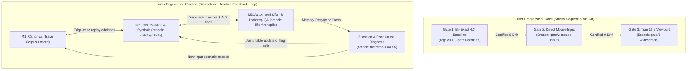
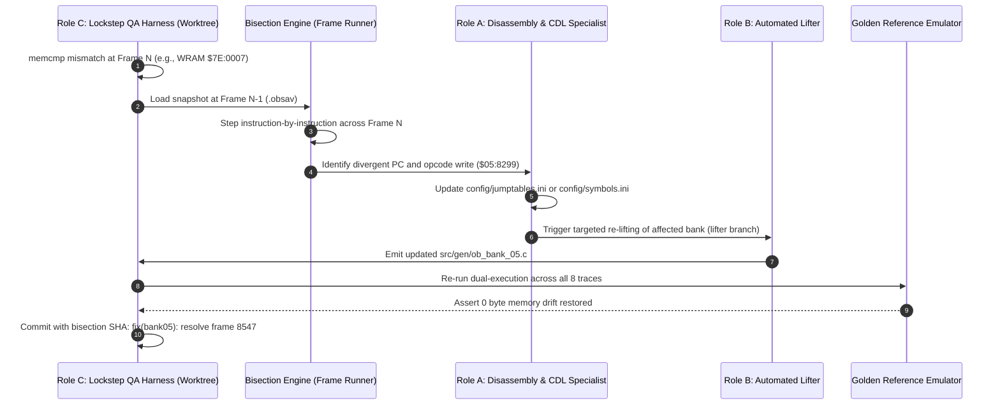
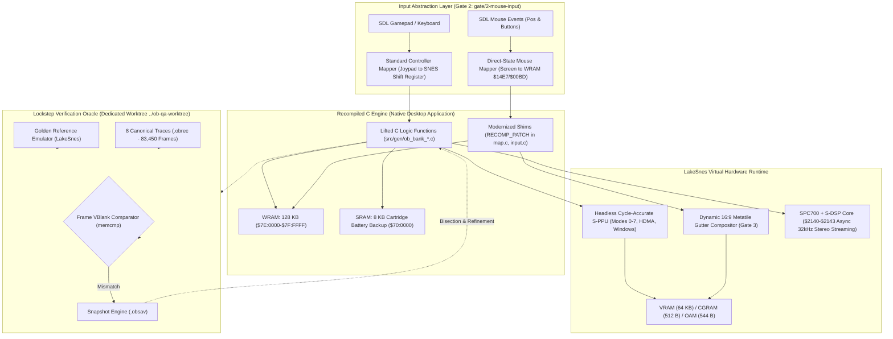

# Master Plan: Ogre Battle: The March of the Black Queen (1:1 Native PC Port)

## 1. Project Overview & Strategy Pivot

The objective is to create an authentic, 1:1 native PC port (Windows/Linux/macOS) of the 1993 Super Nintendo classic **Ogre Battle: The March of the Black Queen** (`Ogre Battle USA`, LoROM 12 Mbit / 1.5 MB), featuring **true 16:9 widescreen tactical map streaming** and **native mouse control**.

### The Strategic Pivot (Post-Gap Analysis)
Historically successful projects like `snesrev/zelda3` stood on 20+ years of mature community disassemblies with ~90% of WRAM variables already named. In contrast, investigation of the *Ogre Battle* reverse engineering ecosystem revealed that the community has documented only the single Reset vector (`$00:8000`) and zero WRAM maps.

Attempting a manual, line-by-line decompilation of ~2,000 undocumented subroutines is guaranteed to stall. Therefore, this project adopts a **Pragmatic Multi-Tier Strategy**:
1. **Tier 1 (Empirical Foundation - Milestones 1 & 2) [COMPLETE]:** Construct an indisputable verification oracle using 8 canonical walkthrough traces (83,450 frames) validated with 0-byte drift in `RM_BOTH` mode, followed by Mesen-S dynamic CDL logging and recursive-descent call graph crawling.
2. **Tier 2 (Automated Static Lifting - Milestone 3 / Gate 1) [100% CERTIFIED]:** Mechanically translate 100% of the ROM's 65816 assembly into raw, instruction-level C (`src/gen/ob_bank_*.c`) using virtual bus routing and the LakeSnes silicon runtime. Formally certified with 0-byte memory drift across all 83,450 frames.
3. **Tier 3 (Selective High-Value Idiomatic Modernization - Milestones 4-6 / Gates 2 & 3) [IN PROGRESS]:** Use `RECOMP_PATCH` to modernize **only** the high-level subsystems required for user experience (`input.c` for mouse control in Gate 2, `map.c` for 16:9 streaming in Gate 3, `unit.c` for stat tracking).

---

## 2. Locked-In Architectural Decisions

| Subsystem | Decision / Selection | Implementation Mechanism |
| :--- | :--- | :--- |
| **Graphics Pipeline** | **Approach 3: Hybrid Extended PPU** | Headless LakeSnes virtual PPU static library for 100% hardware-accurate rendering (color math, HDMA, window masks), paired with C-level function interception (`RECOMP_PATCH`) for tactical map buffer widening. |
| **Widescreen Strategy** | **Expanded Active Map Streaming Buffer (16:9)** | Dynamic scene gating: When `GameMode == MAP_VIEW`, metatile buffer generation expands from $16 \times 14$ to $24 \times 14$ metatiles ($384 \times 224$ or $400 \times 224$). Battle scenes, menus, and tarot cutscenes remain cleanly centered/pillarboxed at 4:3. |
| **Input Pipeline** | **Hybrid Direct-State Mouse & Gamepad** | Window cursor coordinates map directly to WRAM `Cursor_MapX` / `Cursor_MapY` and menu index slots. Left/Right clicks inject `Joypad A` (Confirm/Select) and `Joypad B` (Cancel/Menu). Standard gamepad/keyboard inputs remain active concurrently. |
| **Audio Subsystem** | **Original S-DSP & SPC700 Emulation** | Embedded cycle-accurate SPC700 CPU + DSP core executing original audio driver code asynchronously via the 4 hardware I/O ports (`$2140`–`$2143`), streaming 32 kHz 16-bit stereo PCM to SDL. |
| **Verification & QA** | **Lockstep Dual-Execution Harness (`RM_BOTH`)** | Golden reference emulator runs original ROM alongside the native port frame-by-frame, asserting byte-exact equality across 128 KB WRAM, 64 KB VRAM, OAM, and CGRAM at every VBlank. |
| **Regression Suite** | **8 Canonical Controller Replay Traces (`.obrec`)** | Automated headless test suite evaluating: (1) Boot to Title, (2) Warren's Tarot, (3) Felnamia Deployment, (4) Tactical March & Clock, (5) Battle Encounter, (6) Daskania Liberation, (7) Warren Boss Clear, (8) World Map Battery Save. Certified across 83,450 frames. |
| **Version Control & Repository Architecture** | **Sequential Gate Branching & Worktree QA** | Main branch protected by `test_oracle` pre-push hook; feature gates isolated on `gate/2-mouse-input` and `gate/3-widescreen`; heavy regression testing executed in dedicated `../ob-qa-worktree`; strict `.gitignore` enforcing 0 ROM binaries. |

---

## 3. Two-Tier Progression: Outer Sequential Gates vs. Inner Iterative Feedback Loop

A critical architectural distinction governs this project to prevent both premature modernization (the "cart before the horse" failure mode) and rigid waterfall paralysis:

### 1. Outer Progression Gates (Uni-directional via Git)
* **Rule of the Gates:** Under no circumstances will any subagent or developer write 16:9 widescreen or mouse input code on `main` or merge a gate branch until the predecessor gate is 100% certified with 0 bytes of memory drift in dual-execution lockstep.
* **Gate 1 (Certified):** Tagged at `v0.1.0-gate1-certified` (83,450 / 83,450 frames passing with 0 drift).
* **Gate 2 (Active):** Developed on `gate/2-mouse-input` (direct-state cursor steering, click injection, hybrid input priorities).
* **Gate 3 (Next):** Scheduled on `gate/3-widescreen` (Mode 7 affine scanline expansion, OAM sprite clipping expansion, extended terrain streaming).

### 2. Inner Engineering Pipeline (Iterative & Bidirectional)
* Milestones 1, 2, and 3 are an active feedback loop. When lockstep QA detects an unhandled dynamic jump table, a dedicated fix branch (`fix/bank05-frame8547`) is created, bisected, tested, and cleanly integrated.

---

## 4. Diagnostic Bisection & Re-Discovery Protocol

When a unit test or lockstep frame mismatch is detected, the following protocol is mandatory:

---

## 5. System Architecture Diagram

---

## 6. Repository Infrastructure & Git Quality Gates

1. **Zero Copyrighted Assets in Git (Rule 4):**
   * The repository strictly forbids committing `.sfc`, `.smc`, audio dumps, or decompressed sprite assets.
   * Users supply their own verified ROM (`cfc45162b91791a61d4260e348ad43cb3b2eca0f`), verified at build/launch by `tools/verify_rom.py`.
2. **Deterministic Test Fixture Tracking:**
   * Canonical controller replay traces (`traces/*.obrec`) are tracked directly in Git as immutable test fixtures.
   * Transient files (memory snapshots `.obsav`, diff logs `.diff`, trace screenshots `*_screen.png`) are strictly gitignored.
3. **Dedicated Worktree Isolation:**
   * CPU-intensive regression runs (`test_oracle`) execute in `../ob-qa-worktree` to prevent dirtying the active development working tree.
4. **Automated Verification Hooks:**
   * **Pre-Commit:** Rejects any committed ROM binaries, snapshot dumps, or invalid JSON/INI configs.
   * **Pre-Push:** Runs the smoke test (`trace_01_boot_to_title.obrec`) in `RM_BOTH` mode, blocking any push that introduces memory drift.
5. **Disposable Spikes & Interactive Rebase:**
   * High-risk exploratory work (Mode-7 widescreen shaders, Roster Workbench drag-and-drop) is isolated on `spike/*` branches.
   * Successful utilities are salvaged via `git cherry-pick`, while unviable spikes are pruned cleanly with `git branch -D`.
