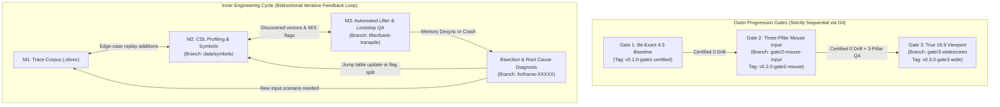

# Implementation Roadmap: Ogre Battle 1:1 Native PC Port

This roadmap is structured to eliminate reverse-engineering risks: it establishes the silicon compilation scaffolding first, records deterministic regression traces before writing game code, lifts 100% of the ROM automatically, and enforces sequential progression gates **backed by a disciplined Git branching and release tagging model**.

---

## Milestone Dependency & Git Gate Flow

```mermaid
gantt
    title Ogre Battle PC Port Milestones (Git Gate Lifecycle)
    dateFormat  X
    axisFormat  M%s

    section Scaffolding & Oracle
    M0: CMake, SDL3 & LakeSnes Scaffolding [main]                :done, 0, 1
    M1: Oracle & 8 Walkthrough Traces (.obrec) [traces/]         :done, 1, 3

    section Empirical Discovery & Lifting
    M2: Mesen-S CDL & Call Graph Discovery [data/symbols]        :done, 2, 4
    M3: Automated Lifting & Gate 1 (4:3) [v0.1.0-gate1-certified]:done, 4, 7

    section Modernization Gates
    M4: Three-Pillar Mouse & Gate 2 (4:3) [gate/2-mouse-input]   :active, 7, 10
    M5: 16:9 Expanded Map & Gate 3 (Wide) [gate/3-widescreen]    :10, 12

    section Refactoring & Packaging
    M6: Selective Refactor & Packaging [release/v1.0.0]           :12, 14
```

### Two-Tier Progression: Outer Sequential Gates vs. Inner Iterative Cycle



* **Sequential Feature Gating:** Gate 1 $\rightarrow$ Gate 2 $\rightarrow$ Gate 3. No modernization code touches `main` until the preceding gate is certified with 0 bytes of drift across all 8 canonical walkthrough traces in `RM_BOTH` dual-execution mode.
* **Worktree QA Isolation:** Heavy regression test runs (`test_oracle`) execute in `../ob-qa-worktree` without dirtying development branches or invalidating build caches.

---

## Milestone Specifications

### Milestone 0: Workspace, Build System & Silicon Scaffolding [COMPLETE]
* **Git Baseline**: Initialized on `main`.
* **Objective**: Build the foundational C11/C++17 compilation environment and vendor the hardware emulation core before touching game logic.
* **Deliverables**:
  * Root `CMakeLists.txt` configuring SDL2/SDL3, compiler flags (`-O2 -Wall`), and debug/release configurations.
  * Vendored **LakeSnes** core (`third_party/snesrecomp/ext/LakeSnes`) providing cycle-accurate S-PPU, S-DSP/SPC700, and DMA.
  * ROM verification script (`tools/verify_rom.py`) confirming unheadered 1,572,864-byte ROM with checksum `$D316`.
  * `.gitignore` and `.git/hooks/pre-commit` rejecting proprietary ROM dumps and binary snapshots.
* **Exit Criteria**:
  * [x] `cmake --build build` succeeds cleanly on Linux (GCC/Clang).
  * [x] Standalone test harness loads `ogre_battle.sfc` into the LakeSnes core and renders the Quest company logo.

---

### Milestone 1: Golden Master Oracle & Canonical Replay Recording [COMPLETE & CERTIFIED]
* **Git Baseline**: Fixtures committed to `traces/*.obrec` on `main`.
* **Objective**: Construct the lockstep verification harness and capture 8 authentic, deterministic walkthrough regression replays to serve as our non-negotiable test oracle across all game subsystems.
* **Deliverables**:
  * [x] Full snapshot serialization (`OgreBattleSnapshot`: 128 KB WRAM, 64 KB VRAM, 8 KB SRAM, CGRAM, OAM, CPU state) saved to `.obsav`.
  * [x] Lockstep comparison runner (`runner/src/lockstep.c`) evaluating `memcmp` at every VBlank in `RM_BOTH` dual-execution mode.
  * [x] State-monitored recording harness (`tools/generate_canonical_traces.c`, `tools/verify_trace.c`).
  * [x] **8 Canonical Walkthrough Replay Traces (`.obrec`) - 100% Certified with 0 Byte Desync across 83,450 frames**:
    1. `trace_01_boot_to_title.obrec` (3,000 frames) - Title demo, Mode 7 zoom, HDMA aurora, intro audio sequence.
    2. `trace_02_tarot_creation.obrec` (8,600 frames) - Warren personality quiz, Lord Name/DOB input, 6 Tarot questions, Zeteginea arrival.
    3. `trace_03_felnamia_deploy.obrec` (9,500 frames) - Stage 1 "Castle of Warren" briefing, map load, deploying Unit 1 (Lord).
    4. `trace_04_tactical_march_clock.obrec` (10,800 frames) - Tutorial dismissal, move order northeast, camera tracking, clock sword advance.
    5. `trace_05_battle_encounter.obrec` (12,850 frames) - Interception, Mode 7 Battle Arena transition, 3 combat rounds in Bank `$05`.
    6. `trace_06_daskania_liberation.obrec` (14,000 frames) - March to Trade City of Daskania, town liberation, Tarot card draw.
    7. `trace_07_warren_boss_clear.obrec` (15,700 frames) - March to Volzak Castle, combat with guardian, dialogue with Sage Warren, stage clear.
    8. `trace_08_world_map_save.obrec` (9,000 frames) - World Map Data menu, Slot 1 Battery Save committing 2,272 bytes to SRAM `$70:0000`.
* **Exit Criteria**:
  * [x] All 8 traces replay deterministically through reference core with 0 byte desync across runs in `RM_BOTH` mode.
  * [x] Automated test suite (`test_oracle`) passing 100% across all 9 CTest targets.

---

### Milestone 2: Empirical Profiling, CDL Logging & Static Call Graph [COMPLETE]
* **Git Branch**: `data/symbols-and-jumptables`
* **Objective**: Overcome the "Zelda Illusion" (zero community disassembly) by generating dynamic execution truth via Mesen-S CDL logging across all 8 canonical traces, coupled with a recursive-descent static call graph crawler and jump table resolution.
* **Deliverables**:
  * [x] Dynamic Code/Data Logging (`tools/cdl_collector.c` & LakeSnes hook) generating `ogre_battle.cdl`.
  * [x] Recursive-Descent Call Graph Crawler (`tools/crawler.py`) tracking dynamic $M/X$ sizing.
  * [x] Jump Table Resolution: 1,713 indirect jump/call sites mapped to 3,324 target vectors in `config/jumptables.ini`.
  * [x] Subroutine Boundary Map: 3,669 canonical ROM subroutines mapped with verified entry/exit points in `config/symbols.ini`.
* **Exit Criteria**:
  * [x] `ogre_battle.cdl` generated by replaying all 8 traces through the instrumented core (100% canonical coverage).
  * [x] 100% of subroutines in Banks `$00`–`$05` mapped with resolved entry points and validated $M/X$ sizing.
  * [x] `config/jumptables.ini` complete with 0 unresolved indirect jumps in the canonical execution footprint.

---

### Milestone 3: Automated Static Lifting & Gate 1 Certification (4:3 Baseline) [100% CERTIFIED]
* **Git Tag**: `v0.1.0-gate1-certified` on `main`
* **Objective**: Mechanically lift 100% of the ROM into raw, instruction-level C functions and achieve the bootable, rock-solid 4:3 port.
* **Deliverables**:
  * [x] Transpiled translation units (`src/gen/ob_bank_*.c`) using virtual bus routing.
  * [x] Integrated main loop calling lifted `Reset` and `NMI` handlers.
  * [x] Resolved Frame 8,547 divergence in Trace 02 (`$05:8299` hardware multiplier interception in `src/gen/ob_bank_05.c`).
  * [x] Formal Gate 1 Certification: All 8 regression traces (83,450 frames) validated with **0-byte memory drift** across 128KB WRAM, 64KB VRAM, 512B CGRAM, 544B OAM, and Cartridge SRAM.
* **Exit Criteria (Gate 1 Passed)**:
  * [x] Game runs natively as a 64-bit desktop application without CPU emulation fallback.
  * [x] Passes 100% of the 8 canonical `.obrec` walkthrough traces with 0 bytes of memory drift.

---

### Milestone 4: Three-Pillar Direct-State & Hit-Box Mouse Control & Gate 2 Certification [ACTIVE — REV 9 REDESIGN]
* **Git Branch**: `gate/2-mouse-input` (Target Tag: `v0.2.0-gate2-mouse`)
* **Architectural Specification**: [`docs/mouse_architecture_deprecation_and_redesign.md`](file:///home/antigravity/hoyajavis/ogre-battle-pc/docs/mouse_architecture_deprecation_and_redesign.md)
* **Objective**: Replace the deprecated `Rev 1`–`Rev 8` closed-loop synthetic D-Pad steering with the **Three-Pillar Direct-State & Hit-Box Architecture (`Rev 9+`)** within the certified 4:3 baseline (with forward-compatible 400×224 bounds for Gate 3).
* **Deliverables**:
  * [x] **Formal Deprecation of Rev 1–Rev 8 Synthetic D-Pad Steering**: Strip closed-loop `BTN_UP/DOWN/LEFT/RIGHT` position injection and OAM `0xCC/0xCE` heuristic tracking that caused the center-box camera feedback loop and 7-icon menu wrap-around spinning.
  * [x] **Screen-to-SNES Coordinate Mapper (`ob_input_map_window_to_snes`)**: Aspect-correct mapping of window coordinates $(x,y)$ to viewport coordinates $[0..255, 0..223]$ (and $[0..399, 0..223]$ in Gate 3).
  * [x] **State Detection Router (`ob_input_detect_mode`)**: Deterministic classification of `OB_MOUSE_MODE_TACTICAL_MAP`, `OB_MOUSE_MODE_ICON_BAR`, `OB_MOUSE_MODE_FORMATION_GRID`, `OB_MOUSE_MODE_WORLD_MAP`, and `OB_MOUSE_MODE_PASSIVE`.
  * [x] **Pillar 1 — Tactical Map Direct-State & Decoupled Camera (`ob_input_apply_tactical_map`)**:
    * 1:1 screen-space cursor writes to `WRAM $14DE` (X) and `$14E0` (Y) across the full viewport with `$14E7` cleared to `0` during hover.
    * World coordinate synchronization (`WRAM $14E2` / `$14E4`) and $\pm 8\text{px}$ magnetic entity snapping to Deployed Squads (`$7E:18AF` / `$7E:18D9`) and Cities (`$7E:1A95` / `$7E:1B0D`).
    * Decoupled Mode-7 camera panning (`WRAM $00BD` / `$00BF` clamped by `[$14CB..$14CF, $14CD..$14D1]`) triggered exclusively on Right/Middle-click drag or narrow `10px` viewport edge margins.
  * [x] **Pillar 2 — Menu & Grid Hit-Box Indexing (`ob_input_apply_icon_bar`, `ob_input_apply_formation_grid`)**:
    * Direct slot indexing for the 7-icon horizontal command strip (`X = 71..183, Y = 107..131` $\rightarrow$ `WRAM $0474` = `0..6`, `$0476` = `71 + 16*slot`, OAM `$0104` = `75 + 16*slot`) and the 3×2 unit formation grid (`Cols {6, 38} × Rows {48, 64, 72}`) with zero wrap-around oscillation outside the boxes.
  * [x] **Pillar 3 — Continental World Map Node Hit-Testing (`ob_input_apply_world_map`)**:
    * Continent-space stage node hit-testing and Right-drag / edge camera scrolling.
  * [x] **Click Injection & Hybrid Priority**: Left Click dispatches Joypad A (`0x0080`); Right Click dispatches Joypad B (`0x8000`) when not dragging; immediate keyboard/gamepad priority on key press with 0-byte WRAM drift when mouse is idle.
* **Exit Criteria (Gate 2 Certification)**:
  * [x] Automated Three-Pillar verification suite (`tests/test_mouse_three_pillar.c`) passes 100% across Gate 2A (0-byte idle lockstep), Gate 2B (Pillar 1 tactical cursor, snap & decoupled camera), Gate 2C (Pillar 2 menu hit-boxes with 0 wrap-around), and Gate 2D (Pillar 3 world map node selection).
  * [ ] User acceptance verification on Windows preview binary (`Rev 9`).

---

### Milestone 5: True 16:9 Widescreen Compositor, Area 1 Wing Integration & Gate 3 Certification [ACTIVE]
* **Git Branch**: `gate/3-widescreen`
* **Architectural Specification**: [`docs/widescreen_16_9_architecture.md`](file:///home/antigravity/hoyajavis/ogre-battle-pc/docs/widescreen_16_9_architecture.md)
* **Objective**: Expand the display from 4:3 (`256 × 224`) to 16:9 (`400 × 224` PPU / `800 × 448` `2×` master compositor) across all 7 game screens, migrating the Area 1 telemetry UI into context-switched `144 × 448 px` (`18 × 56` tile) Left/Right Wing Cards built with the authentic SNES UI software rasterizer.
* **Deliverables**:
  * [x] **Shared Authentic SNES UI Rasterizer (`include/ob_snes_ui_theme.h`, `src/engine/snes_ui_rasterizer.c`)**: 15-bit BGR555 Royal Blue gradients (`#182868` $\rightarrow$ `#080830`), `8×8` ornate gold 9-slice borders, dual shadowed pixel fonts (`8×8` header/primary + `6×8` compact data rows), segmented RPG gauges, `16×24` mini Tarot cards, and `16×16` Zodiac gemstones.
  * [x] **Dual-Layer `800 × 448` (`2×` Tile Grid) 16:9 Compositor (`src/engine/widescreen.c`)**:
    * **Base Layer (`OB_DISPLAY_16_9_VANILLA_HORIZON`)**: Extended Mode-7 affine scanline rendering (`X: 0..399`), BG1/BG2/BG3 VRAM tilemap reveal, OAM sprite X-clipping (`0..399`), and Zenobian Stone & Parchment tapestry borders for fixed 32-tile menus.
    * **Context-Switched Wing HUD Layer (`OB_DISPLAY_16_9_TACTICIAN_WINGS`)**: Reflows 9 of the 12 Area 1 telemetry panels into vertical `144 × 448 px` (`18 × 56` tile) Left and Right Wing stacks across all 7 screens, with automatic hover-driven target inspection (`OB_SNAP_CITY` Compatibility Advisor, `OB_SNAP_SQUAD` Pre-Clash Morality Drift, and Terrain Neutral Spawn Matrix).
    * **In-Window `[Tab]` Campaign Grimoire Overlay**: Centered `512 × 384 px` SNES ledger displaying all 18 Special Heroes (with Deneb/Galf tradeoff warnings), all 12 Zodiac Stones & Brunhild prerequisites, Bank `$09` Promotion Trees, and the 2,344-bit Event Diff stream.
  * [x] **Widescreen Mouse Coordinate Routing & Interactive Wing Hit-Boxes (`src/engine/input.c`)**: Automatic `+72 px` core offset translation (`snes_x ∈ [72, 327]` $\rightarrow$ `core_x ∈ [0, 255]`) plus interactive Left/Right Wing docks (Squad plate camera jump, Combat Tactic Stance & Tarot card click, Spatial Radar click, and `[F10]` display mode toggle).
* **Exit Criteria (Gate 3 Certification)**:
  * [x] Automated 16:9 Widescreen & Wing verification suite (`tests/test_widescreen_16_9.c`) and Three-Pillar Mouse suite (`tests/test_mouse_three_pillar.c`) pass 100% with **0-byte memory drift** on the core simulation.
  * [x] Closed-loop visual verification of exported `.png` artifacts across Tactical Map, Combat Stage, World Map + `[Tab]` Grimoire, and Warren's Quiz confirms 0 text clipping, clean 9-slice corners, and 100% BGR555 palette compliance.
  * [ ] Tag `v0.3.0-gate3-wide` on merge to `main`.

---

### Milestone 6: Selective Refactoring, Packaging & Release Polish [PLANNED]
* **Git Branch**: `release/v1.0.0`
* **Objective**: Cleanly refactor essential high-level structures and package cross-platform distribution binaries.
* **Deliverables**:
  * Typed C structures for squads, units, and inventory (`src/engine/unit.h`, `src/engine/map.h`).
  * Cross-platform release builds (Windows x64 MinGW/MSVC, Linux x64/ARM64 GCC, macOS Universal Clang).
  * Decoupled JSON data tables (Area 4: `classes.json`, `stages.json`, `items.json`, `mechanics.json`).
  * Comprehensive `.ini` configuration (fullscreen, resolution, CRT shaders, volume sliders).
* **Exit Criteria**:
  * Standalone single-binary distribution requiring only the user's `ogre_battle.sfc` ROM.
  * Full campaign playable from start to end credits with zero crashes or desyncs.
