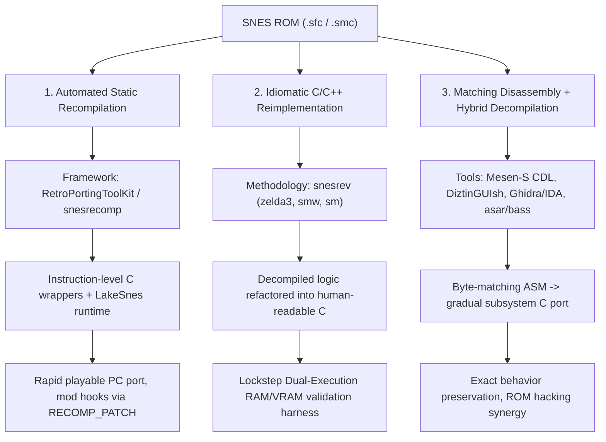
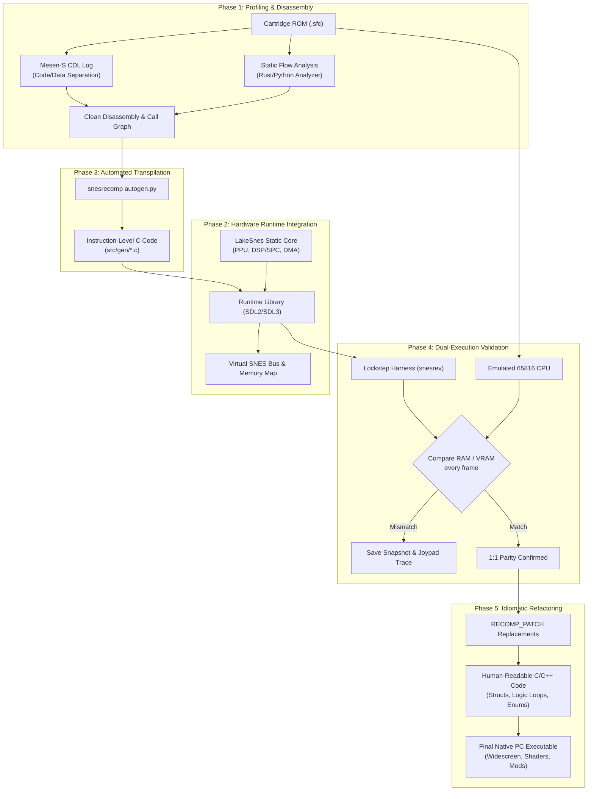

# Architectural Research & Roadmap: SNES ROM Disassembly, Transpilation & 1:1 PC Porting

## Executive Summary

Porting a 16-bit console game from the Super Nintendo Entertainment System (SNES / Super Famicom) to a native, modern PC executable without traditional full-system emulation is accomplished via three primary paradigms in the open-source community:



Below is an in-depth analysis of existing public frameworks on GitHub, the technical challenges inherent to the Ricoh 5A22 (WDC 65C816) CPU and SNES subsystems, and an actionable, phased plan for executing a 1:1 PC port.

---

## 1. Comparative Analysis of Public GitHub Frameworks

### 1.1 `RetroPortingToolKit / snesrecomp` (formerly `sp00nznet`, `mstan`)
* **Repositories**:
  * Core Framework: [`RetroPortingToolKit/snesrecomp`](https://github.com/RetroPortingToolKit/snesrecomp) (and [`sp00nznet/snesrecomp`](https://github.com/sp00nznet/snesrecomp))
  * Showcase Ports: [`mstan/MegaManXSNESRecomp`](https://github.com/mstan/MegaManXSNESRecomp), [`mstan/SuperMarioWorldRecomp`](https://github.com/mstan/SuperMarioWorldRecomp), `SimCity-SNES-Static-Recomp`, `Civilization-SNES-Static-Recomp`
* **Architecture & Mechanics**:
  * **Static Analyzer (`tools/analyzer` / `callgraph.py`)**: Built in Rust and Python. Seeds analysis from native 65816 vectors (Reset, NMI, IRQ), crawls control flow graphs (CFG), tracks register sizing flags ($M$ and $X$), and resolves indirect jump tables (`JMP ($xxxx,X)`).
  * **C Code Generator (`tools/autogen.py`)**: Lifts 65816 routines into C functions using instruction-level inline helpers (`cpu_ops.h` / `gen_ops.h`), translating instructions to functions like `op_lda_imm16()`, `op_sta_dp16()`, `op_rep()`, and `bus_write8()`.
  * **Tiered Fallback Engine**: If static analysis cannot determine jump targets or hits unsupported dynamic constructs, it falls back to an interpreter tier while the port is under development.
  * **Hardware Runtime**: Bundles a headless fork of **LakeSnes** (a clean C SNES emulator) into a static library. The recompiled C code calls standard bus reads/writes, allowing the original PPU (rendering, Mode 7), APU/SPC700 (audio), DMA/HDMA, and controller registers to function without bespoke reimplementation.
  * **Modding / Function Interception**: Uses `RECOMP_PATCH(name, snes_addr)` macros with a static-initialization dispatch table, allowing developers to progressively override generated opcode-level C routines with hand-written idiomatic C.

### 1.2 `snesrev` Engine Reimplementation Paradigm
* **Repositories**:
  * [`snesrev/zelda3`](https://github.com/snesrev/zelda3) (*The Legend of Zelda: A Link to the Past*)
  * [`snesrev/smw`](https://github.com/snesrev/smw) (*Super Mario World*)
  * [`snesrev/sm`](https://github.com/snesrev/sm) (*Super Metroid*)
* **Architecture & Mechanics**:
  * **Transpilation Pipeline**: Initial disassembly combined with IDA Pro analysis (`ida_types.h`) and custom Python transformation scripts (`move_defines.py`), producing structured C code with real `while`/`for` loops, `struct` definitions, typed state variables, and clean function signatures instead of raw opcodes.
  * **Lockstep Dual-Execution Verification Harness (`zelda_cpu_infra.c` / `sm_cpu_infra.c`)**:
    * Runs the original emulated 65816 machine code side-by-side with the transpiled C implementation.
    * Takes frame-by-frame memory snapshots: 128 KB WRAM, 64 KB VRAM, OAM (sprites), CGRAM (palettes), and CPU registers.
    * Automatically triggers a snapshot dump and diagnostic countdown if any memory byte diverges between the original ROM and the native C port.
    * Records joypad input history so any divergence can be deterministically replayed and debugged.
  * **Hardware Integration**: Strips LakeSnes down to its PPU and DSP/SPC700 components, optimizing them and linking them with an SDL2/OpenGL frontend.

### 1.3 `AndreaOrru/gilgamesh`
* **Repository**: [`AndreaOrru/gilgamesh`](https://github.com/AndreaOrru/gilgamesh)
* **Architecture & Mechanics**:
  * Written in modern C++ (Boost, Qt).
  * Focuses specifically on static binary analysis of SNES ROMs to enable automated static recompilation.
  * Implements symbolic execution of the 65816 CPU state, tracking the status register ($M$ and $X$ flag states across branches), stack pointer depth, and hardware register access patterns.
  * Discovers jump tables and constructs accurate call graphs to partition the ROM into discrete subroutines.

### 1.4 ROM-Specific Disassembly Toolchains
* **Examples**:
  * [`BacteriaMage/ogre-battle-disassembly`](https://github.com/BacteriaMage/ogre-battle-disassembly) (C# toolchain specifically designed to disassemble *Ogre Battle: The March of the Black Queen* with symbol databases and address tables).
  * [`dzik87/HarvestMoonSNES`](https://github.com/dzik87/HarvestMoonSNES) (Decompiled assembly matched with `asar`, splitting graphics, audio banks, and logic).
  * [`kandowontu/Starfox-Enhanced`](https://github.com/kandowontu/Starfox-Enhanced) (Disassembly and native rendering enhancement).

---

## 2. Core Technical Obstacles in SNES Transpilation

Disassembling and transpiling 65816 machine code to an idiomatic, high-level language involves challenges unique to the SNES architecture:

### 2.1 Dynamic Register Sizing ($M$ and $X$ Flags)
The 65816 processor can switch the Accumulator ($A$) and Index registers ($X, Y$) between 8-bit and 16-bit modes dynamically at runtime via `REP` and `SEP` instructions:
* `SEP #$20` sets $M=1$ (Accumulator becomes 8-bit).
* `REP #$20` clears $M=0$ (Accumulator becomes 16-bit).
* `SEP #$10` sets $X=1$ (Index registers become 8-bit).
* `REP #$10` clears $X=0$ (Index registers become 16-bit).

**Impact on Disassembly & Transpilation**:
An immediate operand instruction like `LDA #$1234` is 3 bytes in 16-bit mode, but `LDA #$12` is 2 bytes in 8-bit mode. A static disassembler that loses track of $M$ will misinterpret operand bytes as opcodes, causing complete instruction misalignment. Static recompilers must perform path-sensitive dataflow analysis to determine the exact flag state for every instruction.

### 2.2 Segmented 24-Bit Addressing & Direct Page
* **Direct Page ($DP$)**: The 65816 provides a 16-bit relocatable register that moves the 256-byte direct page anywhere in Bank `$00`. Accesses using direct page addressing (`LDA $12`) compute `effective_address = DP + $12`.
* **Data Bank ($DB$) & Program Bank ($PB$)**: Data accesses without 24-bit long addressing default to the Data Bank register. Transpiled code must either emulate a global memory bus `bus_read8(uint8 bank, uint16 addr)` or remap Direct Page and Data Bank structures into C pointers.

### 2.3 Stack Abuse for Control Flow (Jump Tables & Trampolines)
SNES games frequently push addresses onto the stack and execute `RTS` or `RTL` to jump to dynamic functions:
```assembly
PEA (TargetFunction - 1)
RTS    ; Pulls address and jumps!
```
A naive C transpiler mapping `RTS` to `return;` will crash. The transpiler must identify these patterns and convert them into function pointers or `switch` dispatchers.

### 2.4 Sony SPC700 Audio Subsystem
The SNES audio subsystem is completely decoupled from the main CPU. It consists of a Sony SPC700 8-bit CPU, a DSP, and 64 KB of dedicated audio RAM. Communication occurs exclusively over 4 bidirectional 8-bit I/O ports (`$2140`–`$2143`).
* **Porting Approach**: Because the audio driver runs independently, 1:1 PC ports generally do not transpile SPC700 assembly into C. Instead, they embed an emulated SPC700 core (from LakeSnes or Blargg's `snes_spc`) or integrate **MSU-1** for uncompressed CD-quality digital audio.

---

## 3. Step-by-Step Implementation Roadmap

If targeting a specific game (such as *Ogre Battle: The March of the Black Queen*), the recommended approach combines the **`snesrecomp` automated lifting pipeline** with **`snesrev`'s lockstep verification harness**:



### Phase Details

#### Phase 1: Profiling & Code/Data Separation
1. **CDL Logging**: Play through key scenes and battle encounters in **Mesen-S** with the Code/Data Logger active. This tags every byte in the ROM as Code, Data, or Unreached.
2. **Control Flow Recovery**: Run static analysis (`tools/callgraph.py` or `AndreaOrru/gilgamesh`) against the ROM, cross-referencing existing disassembly databases (e.g., `BacteriaMage/ogre-battle-disassembly`).
3. **Jump Table Resolution**: Identify all indirect jump tables (`JMP ($xxxx,X)`) and compile a table of subroutine entry points and sizes.

#### Phase 2: Runtime Scaffolding
1. Instantiate the linkable SNES hardware runtime using `RetroPortingToolKit/snesrecomp` or `snesrev`'s LakeSnes wrapper.
2. Implement SDL2/SDL3 video output, keyboard/gamepad mapping, and audio buffer streaming.
3. Configure the 128 KB WRAM, 64 KB VRAM, and 2 KB SRAM address space.

#### Phase 3: Initial Lifting (Automated C)
1. Run `autogen.py` or the Rust recompilation analyzer to generate raw C functions for every identified routine.
2. Link the generated C against the runtime.
3. Verify that the entry point vector (`ResetVector`) properly initializes hardware registers and enters the main game loop.

#### Phase 4: Lockstep Dual-Execution Validation
1. Enable `RM_BOTH` dual-execution mode:
   * Execute one frame of the original ROM in an emulated CPU core.
   * Execute one frame of the recompiled C code against the native state.
   * Assert `memcmp(mine.ram, theirs.ram, 0x20000) == 0`.
2. Whenever a mismatch occurs, inspect the recorded snapshot, isolate the divergent function, and fix the edge case (e.g., stack manipulation or unhandled decimal mode).

#### Phase 5: Progressive Idiomatic Refactoring
1. Using the `RECOMP_PATCH(name, snes_addr)` pattern, replace mechanical opcode functions one module at a time with clean, idiomatic C/C++:
   * Replace raw array offsets (`g_ram[0x1234]`) with typed data structures (`Unit`, `Squad`, `InventoryItem`).
   * Convert assembly flag tests and branching into standard `if`/`switch` statements.
   * Refactor software tile/palette manipulation into structured helper functions.
2. The lockstep harness continues running during refactoring, ensuring that human-written code never breaks 1:1 gameplay parity.

#### Phase 6: Modern Enhancements
1. **Adaptive Widescreen**: Expand tilemap streaming beyond the standard 256-pixel horizontal boundary.
2. **Quality-of-Life**: Mouse control for menus and tactical maps, instantaneous save states, rewind support, and MSU-1 audio playback.
